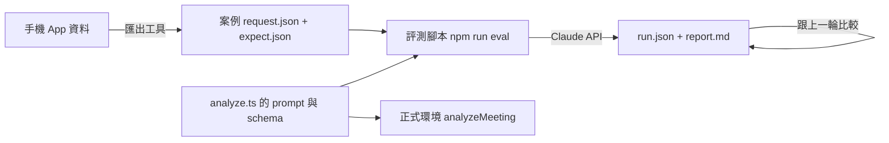

# 分析評測集開發紀錄

分支：`feature/analysis-eval-set`
狀態：已完成（T1～T6 完成、第一輪評測跑完、`/spec-check` 落差已處理），待併入 master

這個分支做了一套在本機執行的「分析評測集」：用固定的會議逐字稿和預期結果，重複呼叫跟正式環境同一份 prompt 和 schema，用程式檢查輸出、產出報告。目的是之後改 prompt 或換模型（評估 Haiku 5.5）時，用數字判斷變好還是變差，不再只靠一次實機手動看。這是 2026-10-30 定案路線的第 ③ 步。規格：[`docs/specs/feature-analysis-eval-set/`](../specs/feature-analysis-eval-set/feature-analysis-eval-set.md)。

## 目標

- 5 筆案例涵蓋：一般單場（C1）、接續上一場（C2）、自訂詞庫（C3）、個人筆記（C4）、30 分鐘以上的真實長會議（C5）。
- 照稿案例進 git（`evals/cases/`）；真實會議只放在 gitignore 的 `evals/private/`。
- 評測腳本跟正式環境共用同一個函式組參數，每筆跑 3 次，報告寫出每項檢查 3 次中通過幾次，並跟上一輪比較。
- 每輪費用上限 US$0.5，開跑前先估算，沒加 `--yes` 只估算不送出。
- 線上分析行為不變。

## 目前進度與下一步

- **已完成**：T1～T6（見規格的「任務拆解」）。第一輪基準 `evals/runs/20261101-0554_claude-haiku-4-5/`（不進 git）：整體 98%，花費 US$0.136。`/spec-check` 找到的 6 項落差都處理了（見規格的「驗收核對記錄」）。
- **下一步**：寫合併說明，使用者確認後用 `--no-ff` 併入 master。
- **合併之後**：
  1. 開 `fix/notes-leak` 修 C4 的兩個 prompt 問題（筆記被寫成會議內容、AI 補充說明的筆數不對），用第一輪當基準比對修改前後。修好的 prompt 要部署，部署前先問使用者，`firebase deploy` 由使用者自己執行。
  2. 路線第 ④ 步：會議紀錄匯出成 HTML。
  3. 路線第 ⑤ 步：用評測集評估 Haiku 5.5（注意它預設開 thinking，會吃 `max_tokens`）。
- **還沒部署**：`functions/src/index.ts` 改成呼叫 `buildAnalysisParams`，參數跟原本完全一樣（有測試），照規格決定 14 等下一次有實際改動時一起部署。
- **怎麼跑**：在 `functions/` 執行 `npm run eval`（先看估算），確認後加 `-- --yes`。key 在 `functions/.env.local` 的 `EVAL_ANTHROPIC_API_KEY`，由使用者自己建立，不要讀出或貼出。新增案例用 `dart run tool/export_eval_case.dart`，App 容器用 Xcode 的 Devices 視窗下載。

## 踩到的坑

### 一、評測工具

#### 費用估算只有實際的四成

**現象**：第一輪開跑前，C1 估算輸入 1,976 token，實際用了 4,599 token。估算總額也跟著偏低。

**原因**：估算用 `messages.countTokens` 算輸入 token，但只帶了 `system` 和 `messages`，沒有帶 `output_config`。結構化輸出的 schema 也會算進輸入，大約 2,600 token。

**修法**：`countTokens` 跟實際呼叫一樣帶上 `output_config`（`functions/eval/run.ts`）。修正後 C1 估 4,602、實際 4,599。附帶發現：加上 schema 之後，短案例也超過 Haiku 4.5 的 4,096 token 快取門檻，所以第 2、3 次都有讀到快取，比原本以為的便宜。

#### 輪次資料夾名稱跟手錶對不上

**現象**：下午 1:54 跑的評測，資料夾名稱是 `20261101-0554`。

**原因**：run id 用 `toISOString()`，那是 UTC 時間。

**修法**：改成本機時間組 `YYYYMMDD-HHmm`。第一輪的資料夾名稱保留不改。

#### 打錯 `--baseline`，花完錢才報錯，結果全部遺失

**現象**：`/spec-check` 核對時讀程式碼發現的，實際沒有發生。指定一個不存在的基準輪時，腳本會先把整輪跑完，最後讀基準輪時才報錯；因為報錯在寫檔之前，`run.json` 和報告都不會留下。

**原因**：基準輪是在跑完之後、寫報告之前才讀。

**修法**：抽出 `loadBaseline`（`functions/eval/report.ts`），在送出第一個請求之前就讀；指定的不存在就直接報錯，不花錢。有測試。

#### 檢查改名之後，跟上一輪比較時會消失

**現象**：同樣是 `/spec-check` 發現的。C5 把「光電」改名成「光電或太陽能」，下一輪的比較表裡兩個名字都不會出現。

**原因**：`compareRuns` 只比較兩輪都有的檢查，只有「案例」會標新增或移除，「檢查」不會。

**修法**：`compareRuns` 多回傳 `addedChecks`、`removedChecks`，報告列出「新增的檢查」「已移除的檢查」。有測試。

### 二、App 程式結構

#### 組 request 的程式不能用純 Dart 執行

**現象**：匯出工具要呼叫 App 組 request 的函式（`buildHighlights`、`segmentIndexFor`），但 `dart run` 載不進來。

**原因**：這些函式放在 `lib/services/analysis_service.dart`，這個檔案 import 了 `cloud_functions`（Flutter 外掛），純 Dart 執行不了。

**修法**：把整個組 request 的邏輯搬到純 Dart 的 `lib/services/analysis_request.dart`（`buildAnalysisRequest`），App 的 `AnalysisService.analyze` 和匯出工具都呼叫它；`analysis_service.dart` 再 export 這個檔案，原本的 import 不用改。

### 三、分析品質（評測集抓到的，修正留給 `fix/notes-leak`）

#### 使用者筆記被寫成會議內容（C4，3 次中 2 次）

**現象**：使用者自己的筆記「民宿要問能不能帶寵物」被寫進待辦（「尋找民宿並詢問是否可帶寵物」）、摘要重點和會議紀錄的決議。另一則跟逐字稿矛盾的筆記「決定改去花蓮」三次都有被擋下來。

**原因**：prompt 規則擋得住跟會議矛盾的筆記，但擋不住「看起來像會議待辦補充」的筆記。

**修法**：這個分支不改分析行為，留到 `fix/notes-leak`。

#### 其他

- C4 的 AI 補充說明，3 則筆記有一次只回 1 筆（prompt 問題，同上）。
- C2 的新主題有一次漏了「預算」：模型不穩定，檢查不改，之後繼續觀察。
- C5 的摘要寫「太陽能發電」而不是「光電」：是預期結果寫太嚴，已放寬成「光電或太陽能」。
- C5 的逐字稿第 41 段是 whisper 把詞庫提示誤轉成逐字稿（Flutter、PostureCheck、EchoNote…）。這不是這個分支要修的，但正好拿來當陷阱：這些詞不可以出現在輸出裡。三次都通過。

## 測試方法

- **functions**：`cd functions && npm test`，29 個全部通過（2026-11-01）。包含：
  - `analyze.test.ts`：`buildAnalysisParams` 的預設參數跟改動前一致、只能換模型、prompt 版本雜湊。
  - `grade.test.ts`：每一種檢查各有通過和失敗的例子、5 項通用檢查。
  - `eval.test.ts`：價格與估算、讀案例（格式錯誤開跑前就失敗）、通過次數、跟基準輪比較（含新增或移除的檢查）、報告的註記、`loadBaseline`。
- **Flutter**：`flutter test`，235 個全部通過（2026-11-01），含匯出工具的 5 個測試（`test/tool/export_eval_case_test.dart`，用假的 App 容器資料夾）。
- **實際評測**：第一輪 `20261101-0554_claude-haiku-4-5`，prompt `52d3aa9b`，commit `eab4510`。5 筆 × 3 次，整體 98%（234/240 項次），花費 US$0.136（估算 US$0.264）。使用者看過報告附錄的原始輸出，判斷跟程式評分「差不多」一致；唯一不一致的 C5「光電」已修正預期結果。
- **C5 沒進 git**：`git check-ignore -v evals/private/c5-solar-policy-long/expect.json` 命中 `.gitignore:54`。

## 待辦／已知限制

- `index.ts` 的重構還沒部署（決定 14）。
- 不用 LLM 評分；目前只有關鍵字檢查，同義詞要靠 `any_of` 多列幾種說法。
- 價格表是寫死的（2026-11-01 查證），換模型或官方調價時要更新 `functions/eval/pricing.ts`。
- C6～C7（更多真實會議）這一版沒做。
- 沿用跨會議記憶留下的待辦：分析途中離開頁面又失敗時沒有提示；`firebase-functions` 套件版本過舊；App Check 斷網訊息要實機重測。

## 合併說明（2026-11-01）

範圍：整個分支

### 改了什麼

- 新增「分析評測集」：5 筆固定的會議案例（一般單場、接續上一場、自訂詞庫、個人筆記、31 分鐘真實長會議），每筆附上預期結果。真實會議只存在本機，不進 git。
- 新增本機評測腳本：用跟正式環境同一份 prompt 和輸出格式呼叫 Claude，每筆跑 3 次，用程式檢查「該出現的有沒有出現、不該出現的有沒有出現、待辦和決議的變化對不對」，寫出報告並跟上一輪比較。開跑前先估算費用，超過 US$0.5 就不送出。
- 新增匯出工具：從手機下載的 App 資料，把一場會議轉成案例，內容跟 App 實際送出的一模一樣。
- 重構（使用者看不到）：正式環境和評測改用同一個函式組分析參數（`buildAnalysisParams`）；App 組 request 的程式搬到不依賴 Flutter 外掛的檔案（`analysis_request.dart`），讓匯出工具也能用。

### 怎麼證明能用

- **實際評測**：第一輪 `20261101-0554_claude-haiku-4-5`，5 筆 × 3 次，整體 98%（234/240 項次），花費 US$0.136。抓到兩個真的 prompt 問題（C4 筆記被寫成會議內容），留給 `fix/notes-leak`。
- **人工對照**：使用者看過報告附錄的原始輸出，判斷跟程式評分一致；唯一不一致的（C5「光電」太嚴）已修正。
- **參數沒變**：`analyze.test.ts` 確認 `buildAnalysisParams` 的模型、`max_tokens`、system、messages、輸出格式跟改動前一樣。
- **App 行為沒變**：搬移組 request 的程式後，`flutter test` 235 個全部通過。
- **評測工具**：functions 29 個測試全部通過，含評分、估算、跟上一輪比較、基準輪讀取。
- **規格核對**：`/spec-check` 找到 6 項落差，已全部處理（見規格的「驗收核對記錄」）。
- **未驗證**：`index.ts` 改呼叫共用函式的版本還沒部署到正式環境；參數一致由測試保證，照規格決定 14 等下次改 prompt 時一起部署。

### 出事能不能退回

**雙向門**：沒有資料格式、資料庫或線上行為的改動；正式環境還在跑舊版程式。`git revert` 就能完全復原。
**影響範圍**：開發工具——App 端只是把程式搬到另一個檔案，送出的內容不變；評測只在開發者的電腦上執行，用另一把 API key。
