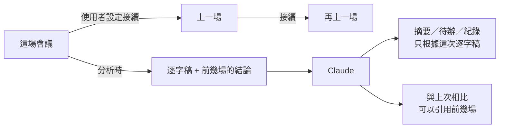

# 跨會議記憶（接續上一場會議）開發紀錄

分支：`feature/cross-meeting-memory`
狀態：已完成（function 已部署到正式環境、實機驗收通過、`/spec-check` 無落差），待併入 master

使用者可以把一場會議設定成「接續」更早的某一場。分析時，App 把前幾場的結論（不含逐字稿）一起交給 Claude，摘要多一張「與上次相比」：上次的待辦這次進展到哪、哪些決議被延續、修改或推翻、這次新出現了什麼。起因是 2026-10-30 討論 Anthropic 的 knowledge-work-plugins，這是路線的第 2 步，讓 EchoNote 從「整理一場會議」變成「會議記憶」。規格：[`docs/specs/feature-cross-meeting-memory/`](../specs/feature-cross-meeting-memory/feature-cross-meeting-memory.md)。

## 目標

- 手動設定接續，只能選更早、已分析的場次；往前追溯最多 3 場。
- 只送結論：標題、日期、摘要、決議、待辦（含使用者的勾選）。不送逐字稿、筆記、出席者。
- 新增 `follow_up` 輸出和「與上次相比」卡片，每一筆可以點時間跳到那段播放。
- 前幾場的內容不可以被寫成這次的發言。

## 目前進度與下一步

- **已完成**：T1～T4、追加修正 F1～F3 全部完成（見規格的「任務拆解」「追加修正」）。function 已部署兩次（T4、F2），實機用驗收稿重測通過。
- **下一步**：用 `--no-ff` 併入 master 並 push。
- **之後的路線**：分析評測集（第一筆案例就是 [`acceptance-script.md`](../specs/feature-cross-meeting-memory/acceptance-script.md)）→ 會議紀錄匯出成 HTML → 評估換成 Haiku 5.5。
- **留到之後的待辦**（規格的「待辦」）：分析途中離開頁面，失敗時沒有提示；「複製摘要」不含「與上次相比」。

## 踩到的坑

### 一、測試

#### widget 測試裡，畫面讀不到測試存的會議

**現象**：widget 測試先用 `RecordingStore` 把幾場會議存到暫存資料夾，再開詳細頁。畫面的 `loadAll()` 一直沒有回來，選單是空的，5 個測試全部失敗。在 `tester.runAsync` 裡多等 50 毫秒也沒用。

**原因**：widget 測試跑在假時鐘（FakeAsync）裡，真的檔案讀寫要靠真實的事件迴圈才會完成。`loadAll()` 連續好幾個 `await`（取資料夾、列檔、逐一讀檔），每一步都需要真實時間和一次 pump，等一次不夠。

**修法**：`MeetingDetailScreen` 加上選填的 `store` 參數，測試傳入記憶體版的 `RecordingStore`。之後的分析服務和詞庫也用同樣的方式注入（`analysisService`、`glossary`）。App 本身不傳這些參數，行為不變。

#### 選單裡的「重新分析」找到兩個

**現象**：測試點「⋯」→「重新分析」時，`find.text('重新分析')` 找到兩個元件，`tap` 失敗。

**原因**：接續改變之後，過時橫幅本身也有一顆「重新分析」按鈕。

**修法**：用 `.last` 點選單項目，因為選單疊在最上層，並在測試裡註明原因。

### 二、介面

#### 加了第 4 顆按鈕，標題被擠成「官網改…」

**現象**：實機上，AppBar 有接續、重新分析、重新轉錄、刪除 4 顆圓形按鈕，中文標題只剩 3 個字。

**原因**：iPhone 寬度下，返回鍵加 4 顆 38 點的按鈕，吃掉大半條 AppBar。

**修法**：做了三個方案給使用者挑（[AppBar 三案](https://claude.ai/artifact/KssNYVtw5ZFcQpWqP3J4PD)），使用者選 A：4 個動作全部收進一個「⋯」選單，之後的匯出也放這裡。

#### 重新分析時，畫面看起來什麼都沒發生

**現象**：已經分析過的會議按重新分析，只有「⋯」變灰，舊摘要照常顯示，要等十幾秒到半分鐘才突然換掉。

**原因**：只有第一次分析的按鈕有「分析中...」，重新分析沒有任何提示。

**修法**：做了三個方案（[等待提示三案](https://claude.ai/artifact/GWCcpmAqzFwTVosyXBEww2)），使用者選 A：頂部進度橫幅，跟重新轉錄同一套樣式，顯示經過的秒數，完成時提示「分析完成，內容已更新」。

### 三、分析品質

#### 「主色藍改綠」被判成修改，「維持中文版」沒列出來

**現象**：第一次照稿實機驗收，待辦進度和陷阱檢查都正確，但「不用藍色了，改成綠色」被標成「修改」，「維持原本的決定，先只做中文版」完全沒出現。

**原因**：prompt 只列出 continued／revised／reversed 三個值，沒有定義。模型把「換選項」當成修改，也把「沒變的決議」當成不用列。

**修法**：prompt 補上三種變化的定義和例子（延續＝重申維持，一定要列；修改＝方向不變、調整細節；推翻＝取消或換成另一個選項）。部署後用同一份稿子重測，兩項都正確。驗收稿存成 `acceptance-script.md`，當作評測集的第一筆案例。

### 四、部署

#### 第二次部署被 Claude Code 的權限檢查擋下

**現象**：F2 的 `firebase deploy --only functions` 被自動權限檢查判定為「正式環境部署」而拒絕。第一次（T4）部署沒有被擋。

**修法**：沒有繞過，改由使用者自己執行部署。要讓 agent 部署，需要在 Claude Code 設定加允許規則；即使加了，部署前仍要先問使用者（app-check 決定 17）。

---

## 測試方法

- **自動化**：
  - `flutter test` 230 個全部通過（這個分支新增 26 個）；`flutter analyze` 沒有問題；`flutter build ios --no-codesign` 通過。
  - `functions/` 的 `npm test` 10 個通過（新增 7 個：`previous_meetings` 的驗證、送給 Claude 的內容、`follow_up` schema）。
  - 新的測試檔：`functions/test/analyze.test.ts`、`test/services/meeting_chain_test.dart`、`test/services/follow_up_test.dart`、`test/screens/meeting_detail_previous_test.dart`。
- **實機驗收**（2026-10-31，Profile，用 [`acceptance-script.md`](../specs/feature-cross-meeting-memory/acceptance-script.md) 錄兩場「官網改版週會」）：
  1. 沒設定接續的會議：分析結果照舊，沒有「與上次相比」。
  2. 設定接續：選單只列出更早的場次，摘要上方顯示「接續：…」，出現「接續的會議變了」提醒。
  3. 第一次重新分析：上次的 4～5 筆待辦判斷正確，「這次沒提到」排最後；新主題有 FAQ 頁、預算；陷阱（只在第一場出現的 Meetup 贊助、申請網域）沒有被寫進這次的摘要、待辦和會議紀錄。決議有兩項不對（見坑三）。
  4. 補 prompt 定義、部署後重測：主色判成推翻，「先只做中文版」列成延續。
  5. 「⋯」選單：標題完整顯示。
  6. 重新分析的橫幅：秒數在跑、可以切分頁、完成時有提示。

## 待辦／已知限制

- 分析途中離開詳細頁：結果照樣存檔，但失敗時沒有任何提示。
- 「複製摘要」不包含「與上次相比」，跟 HTML 匯出一起處理。
- 日期是加入 App 的時間：匯入舊錄音時，日期和前後順序可能跟實際開會不同，畫面上有註明。
- 前一場重新分析之後，接續它的場次不會提示要更新。
- 分析品質目前只有一組稿子驗證過，下一步的評測集要補更多案例。
- `firebase-functions` 套件版本過舊（部署時有警告），升級可能有 breaking change，另外處理。

## 合併說明（2026-10-31）

範圍：整個分支（併入 `master`）

### 改了什麼

- **會議可以接續上一場**：在會議頁的「⋯」選單選「接續上一場」，只能選更早、而且已經分析過的會議。
- **分析時會參考前幾場的結論**：最多往前 3 場，只送標題、日期、摘要、決議和待辦，不送逐字稿，所以費用幾乎不變。
- **摘要多一張「與上次相比」**：分成三段。
  - 上次的待辦：已完成、進行中，或這次沒提到。
  - 決議的變化：延續、修改，或推翻。
  - 新的主題。

  有時間的項目點了會跳到那段錄音。
- **前幾場的內容不會被寫成這次的發言**：AI 被明確規定，只有「與上次相比」可以引用之前的會議。
- **會議頁的按鈕收進「⋯」選單**：重新分析、重新轉錄、刪除也都收進去，標題不再被擠短。
- **分析時看得到進度**：頂部顯示「正在重新分析…」和經過的秒數，完成時提示「分析完成，內容已更新」。

### 怎麼證明能用

- **正式環境實機驗收**（iPhone，Profile）：用兩場照稿錄的「官網改版週會」測試。
  - 上次的待辦、新的主題都判斷正確。
  - 只在第一場講過的 Meetup 贊助、申請網域，沒有出現在第二場的摘要、待辦和紀錄裡。
  - 決議的變化：第一次測試有兩項判斷錯誤，補上定義後重測全部正確。
- **改動前後**：AppBar 改動前，標題被擠成「官網改…」（實機截圖）；改動後可以完整顯示。
- **自動化**：`flutter test` 230 個通過（新增 26 個）；functions 的 `npm test` 10 個通過（新增 7 個）；`flutter analyze` 沒有問題；`flutter build ios` 通過。
- **未驗證**：
  - 分析品質只用一組稿子驗證過，要等評測集做好，才有更多案例。
  - 分析途中離開頁面又失敗的情況，沒有提示，也沒有測。

### 出事能不能退回

**大致是雙向門**：
- **雲端分析服務**：已經部署新版。只做 `git revert` 不會恢復線上行為，要再部署一次舊版。新版只多了選填欄位，舊版 App 照常能用。
- **本機資料**：新增的接續欄位和「與上次相比」都是選填。退回舊版 App 後，舊資料照常讀得到，只是這兩個欄位會被忽略，下次存檔時就會消失。

**影響範圍**：會議分析。每一場會議的分析都會用到新版 prompt，包括沒有設定接續的會議。錄音、轉錄和本機紀錄不受影響。
