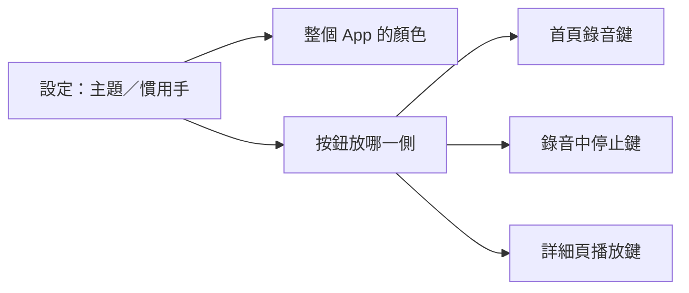

# 深色主題、圓形樣式與單手操作 開發紀錄

分支：`feature/dark-theme`
狀態：已完成（實機驗收通過），待併入 master

起因是首頁的時長加上顏色後，使用者覺得整個 App 太單調。我先用 HTML 樣稿給 5 個配色選擇，使用者選了深色版本 E。看過套到各頁的樣稿後，使用者又提出四點：

- 元素一律改成圓形
- 新增設定頁，可以選深淺色和左右手
- 錄音時按鈕要靠拇指那一側
- 詳細頁的分頁和播放列太靠上，單手不好按

第二版樣稿確認後才動程式。規格：[`docs/specs/feature-dark-theme/`](../specs/feature-dark-theme/feature-dark-theme.md)；樣稿：<https://claude.ai/artifact/6sqztWevMdtZ43iGtYeTwM>。

## 目標

- 深淺兩套配色，加上跟隨系統，預設深色。青色是「可以點或強調」，琥珀色是「要注意」，綠色是「完成」，紅色只用在錄音、停止、刪除。
- 按鈕、標籤、時間戳記改成膠囊形，圖示放在圓形底裡，文字和清單用圓角卡片包起來，所有頁面一致。
- 新增設定頁，可以選主題和慣用手。首頁的錄音鍵、錄音中的停止鍵、詳細頁的播放鍵，都放在拇指那一側。
- 詳細頁的分頁移到底部，播放列放在分頁正上方。

## 踩到的坑

### 一、樣稿第一次打開是空白的

**現象**：樣稿第二版發布後，使用者打開只看到標題、開關和規則說明，7 個畫面都沒出來。

**原因**：樣稿裡有個函式取名叫 `top`。瀏覽器的全域已經有不能覆蓋的 `window.top`，用 `const top` 宣告會直接出錯，整段程式都不執行。

**修法**：函式改名成 `topBar`，用 `node --check` 檢查語法後重新發布。之後寫樣稿時，全域名稱要避開 `top`、`name`、`status` 這類瀏覽器內建的名字。

### 二、`dart format` 把整個專案重排了

**現象**：T1 換顏色時對 `lib/` 跑了 `dart format`，結果 25 個檔案被改動，analyze 也多了幾則提示。

**原因**：專案是手動排成大約 100 字寬，`dart format` 的預設是 80 字寬。

**修法**：把 `lib/` 全部還原，只重新套用這次真正要改的地方。之後只對整個重寫的單一檔案跑 `dart format -l 100`。

### 三、只測單一畫面的測試沒有設定可讀

**現象**：首頁、錄音畫面、詳細頁要依慣用手排版。但現有的測試只把單一畫面包進 `MaterialApp`，上面沒有 App 層的設定。

**修法**：設定用 `AppSettingsScope`（`InheritedNotifier`）往下傳，找不到就用預設值，也就是深色、右手。現有測試不用改；要測左手的測試，自己包一層 scope（`lib/services/app_settings.dart`）。顏色也用同樣的做法：`AppColors.of` 找不到主題擴充時，退回深色配色。

### 四、深色背景閃一下淺色

**現象**：設定要從檔案讀。如果等第一個畫面出來才讀，選了淺色的人開 App 時會先閃一下深色。

**修法**：在 `runApp` 之前先讀完設定（`lib/main.dart`）。

### 五、測試按不到停止

**現象**：錄音畫面改版後，「錄音會存時長」的測試失敗，找不到歷史紀錄。

**原因**：停止鍵改成圓形圖示按鈕，下面的「停止」只是說明文字。測試用 `find.text('停止')` 點到的是文字，錄音根本沒有停。

**修法**：改用 `find.byTooltip('停止錄音')` 點按鈕（`test/screens/live_record_screen_test.dart`）。

---

## 測試方法

- **自動化**：`flutter test` 183 個全部通過，`flutter analyze` 沒有問題，`flutter build ios` 通過。新增 23 個測試：
  - 主題 4 個：兩套配色、圓形元件、切換後馬上生效
  - 設定 7 個：讀寫和預設值、設定頁
  - 首頁 3 個：右手和左手的按鈕位置、一鍵錄音
  - 錄音畫面 3 個：右手、左手、手機尺寸下不溢出
  - 詳細頁 6 個：底部分頁和滑動、右上角按鈕的顯示條件、重新分析先確認、播放列時間和慣用手、手機尺寸下四個分頁不溢出
- **實機**（iPhone 12 Pro Max，使用者）：
  - 開 App 直接是深色
  - 首頁一鍵錄音
  - 錄音畫面的下方操作區
  - 詳細頁的底部分頁和播放列
  - 淺色和跟隨系統
  - 左手模式
  - 重開 App 後設定還在

  以上全部正常。單手拿手機時好按，畫面不需要再調整。

## 待辦／已知限制

- **桌面模式**：手機平放時只留「標記重點」和「停止」。要加感測器套件，另開 `feature/desk-mode`。
- **逐字稿標示正在播放的句子**：決定 7，之後另開一項。
- **Android**：沒有實機驗證。

## 合併說明（2026-10-22）

範圍：整個分支（併入 `master`）

### 改了什麼
- **深色主題**：整個 App 換成深色，也可以在設定改成淺色或跟隨系統。顏色有固定的意思：青色可以點，琥珀色要注意，綠色已完成，紅色只用在錄音和刪除。
- **一致的圓形外觀**：按鈕、標籤是膠囊形，圖示放在圓形底裡，每段內容用圓角卡片包起來，所有頁面一樣。
- **設定頁**：首頁右上角的齒輪，可以選主題和慣用手。
- **單手好按**：
  - 首頁右下角是大的紅色錄音鍵，按一下就開始錄。
  - 錄音時的停止鍵和詳細頁的播放鍵，都在拇指那一側；選左手就全部換到左邊。
  - 詳細頁的分頁和播放列移到畫面下方。
- **重新分析先確認**：重新分析會取代原本的結果，連待辦的勾選也會重來，所以現在會先問一次。

### 怎麼證明能用
- **樣稿確認**：動程式前用 HTML 樣稿給使用者選配色，再確認各頁的版面（https://claude.ai/artifact/6sqztWevMdtZ43iGtYeTwM）。
- **實機驗收**（iPhone 12 Pro Max）：深色、淺色、跟隨系統、左手模式、首頁一鍵錄音、錄音畫面、詳細頁底部分頁都正常；單手好按。
- **自動化測試**：183 個通過，新增 23 個，包含左右手的按鈕位置，以及手機尺寸下各畫面不溢出。
- **未驗證**：Android 實機。

### 出事能不能退回
**雙向門**：只改外觀和版面，加上設定檔多兩個選填欄位（舊版會忽略）；錄音紀錄的格式沒有改，`git revert` 就能完全復原。
**影響範圍**：所有畫面——功能和資料不變，但每一頁的外觀都換了，按鈕位置也有調整。
