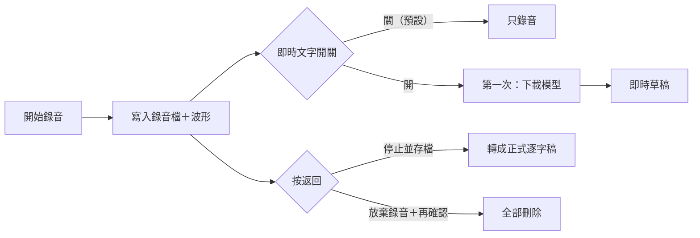

# 錄音狀態指示與即時文字開關 開發紀錄

分支：`feature/recording-indicator`
狀態：已完成（實機驗收通過、`/spec-check` 落差已處理），待併入 master

這個分支把錄音中的即時文字改成**預設關閉**、需要時再打開，並用捲動波形和呼吸紅點讓「正在錄」更明確；實機驗收時又加上「放棄這次錄音」。起因是 2026-10-22 的討論：主打錄完再精修的競品（Plaud、Good Tape）不顯示即時文字，而 EchoNote 錄音中顯示的是 `tiny` 草稿，品質明顯比最後的逐字稿差，會讓使用者誤會轉錄不準。規格：[`docs/specs/feature-recording-indicator/`](../specs/feature-recording-indicator/feature-recording-indicator.md)。

## 目標

- 即時文字預設關閉；關閉時完全不啟動辨識，只寫 WAV、算音量。錄音中可以隨時打開或關閉，選擇會記住。
- `tiny` 模型第一次打開即時文字時才下載，從沒用過的人省下約 75 MB。
- 捲動波形（最近 6 秒）取代音量條，紅點呼吸閃爍；系統開啟「減少動態效果」時紅點常亮。
- 錄音中按返回可以放棄這次錄音，什麼都不留。

## 踩到的坑

### 一、錄音和辨識綁死，關不掉也測不了

**現象**：要讓「關閉時不啟動辨識」成立，發現 `LiveRecording` 一定要有辨識 session：預覽文字、延遲提示、debug 統計、停止時的最終文字都直接讀它。也因為這樣，`LiveRecording` 一直沒有單元測試，要有真的原生辨識才能建立。

**原因**：`LiveTranscriptionService.start()` 一開始就呼叫 `transcribeLive()`，把 session 塞進 `LiveRecording` 的私有建構子。

**修法**：辨識改成透過 `PreviewSession` 介面注入，`LiveRecording` 可以沒有 session，並新增 `startPreview()`／`stopPreview()` 在錄音中途開關（`lib/services/live_transcription_service.dart`）。中途打開時，延遲以「這次辨識開始的位置」為起點計算；重新打開是新的 session，文字不接前一段。`LiveRecording` 第一次有了單元測試（用假的麥克風音訊和假的辨識）。

### 二、辨識失敗不該讓錄音失敗

**現象**：原本的流程是「先開辨識、再開麥克風」，`tiny` 下載或辨識啟動失敗時，整段錄音直接失敗。

**原因**：辨識是錄音的前置條件。

**修法**：錄音一律先不帶辨識開始，開始之後才依設定打開即時文字。下載或辨識失敗時，開關退回關閉、顯示提示，錄音照常進行。

### 三、設定值的型別不對會丟例外

**現象**：設定檔的測試把 `live_preview` 寫成字串 `"yes"`，讀取時丟出 `TypeError`。

**原因**：`as bool?` 遇到字串會丟例外，而這行不在 try 的範圍內。

**修法**：先判斷 `value is bool`，不是就當作預設值（`lib/services/settings_store.dart`）。

### 四、規格裡兩條決定互相矛盾

**現象**：實作 T4 時發現，決定 1 寫「中途關閉時，已顯示的文字保留」，但 UI 表格寫「關閉時不顯示預覽區」，再加上決定 7「重新打開時清空」，保留的文字永遠看不到。

**原因**：寫規格時，「錄音中切換」和「畫面呈現」分開想，沒有對起來。`/spec` 的反查那一輪也沒抓到。

**修法**：照 UI 表格實作，回報後使用者決定修訂決定 1：中途關閉就停止辨識並隱藏預覽區。

### 五、widget 測試被轉場動畫拖慢到 3 分鐘

**現象**：「放棄錄音」的兩個測試各花約 85 秒，整個測試檔從 9 秒變成 3 分鐘。一開始以為是 `tester.pageBack()` 會等動畫結束，而呼吸紅點永遠不會停；改成直接點返回鍵後還是一樣慢。

**原因**：用時間戳記一步一步量，發現慢的是 `runAsync`：推入新頁面或開對話框後，原本 20 ms 的等待變成約 680 ms。`settle` 每輪呼叫的 `pump()` 沒帶時間，假時鐘不會前進，頁面轉場一直停在半路，拖慢了之後每一次 `runAsync`。

**修法**：`settle` 每輪改成 `pump(const Duration(milliseconds: 50))`，讓轉場和對話框動畫跑完，測試檔回到 20 秒（`test/screens/live_record_screen_test.dart`）。

### 六、記住的選擇是「打開」時，畫面測試偶爾失敗

**現象**：「記住的選擇是打開」的兩個畫面測試失敗，開關是關的。

**原因**：開始錄音要依序讀寫好幾個檔案（錄音資料夾、WAV、設定檔），測試等的輪數不夠，設定還沒讀完就檢查了。

**修法**：`settle` 的輪數從 8 加到 25。

---

## 測試方法

- **自動化**：`flutter test` 138 個全部通過，`flutter analyze` 沒有問題，`flutter build ios` 通過。新增：`LiveRecording` 單元測試 6 個、設定檔 5 個、波形與紅點 8 個、錄音畫面 widget 測試 7 個（預設關閉、記住打開、中途打開、關閉、下載失敗、放棄錄音、取消放棄）。
- **實機**（iPhone 12 Pro Max，使用者）：預設關閉、中途打開與第一次下載 `tiny`、關掉再打開、記住選擇、減少動態效果都正常；放棄錄音時，第二次確認取消會繼續錄，確定放棄後清單沒有多一筆。
- **耗電與溫度**：開、關即時文字各錄 10 分鐘，**差異不明顯**。所以預設關閉的理由是預覽品質，不是省電。

## 待辦／已知限制

- 鎖螢幕或切到其他 App 時錄音會停止（`LiveEndReason.backgrounded`）。使用者確認這不是預期行為，要另開一項，評估 iOS 背景錄音或錄音時讓螢幕保持不熄滅。
- 錄音畫面的版面、顏色都是暫定，待正式設計。
- `LiveRecordingResult.previewText` 在服務以外沒有地方用到，這次保留沒刪。
- Android 沒有實機驗證。

## 合併說明（2026-10-22）

範圍：整個分支（併入 `master`）

### 改了什麼
- **即時文字預設關閉**：錄音畫面右上角新增「即時文字（草稿）」開關。關閉時手機不做即時辨識，只錄音；打開時跟以前一樣。錄音中可以隨時切換，App 會記住上次的選擇。
- **第一次打開才下載**：即時文字用的語音模型（約 75 MB），第一次打開時才下載，畫面會顯示進度；下載失敗時，開關自動退回關閉，錄音不受影響。
- **確認「正在錄」更清楚**：音量條換成最近 6 秒的捲動波形，紅點會一明一暗地閃。手機開啟「減少動態效果」時，紅點改成常亮。
- **可以放棄錄音**：錄音中按返回，除了「繼續錄音」「停止並存檔」，還可以「放棄錄音」；再確認一次後，錄音和筆記都刪掉，就像沒錄過一樣。

### 怎麼證明能用
- **實機驗收**（iPhone 12 Pro Max）：預設關閉、錄音中打開（含第一次下載）、關掉再打開、記住選擇、減少動態效果、放棄錄音（取消與確定）都正常。
- **自動化測試**：138 個通過；錄音核心第一次有單元測試，另有錄音畫面 7 個 widget 測試，涵蓋開關、下載失敗、放棄錄音。
- **耗電與溫度**：開、關各錄 10 分鐘，差異不明顯。即時文字預設關閉是為了避免草稿品質讓人誤會轉錄不準，不是為了省電。
- **未驗證**：Android 實機。

### 出事能不能退回
**雙向門**：錄音存檔的格式沒有改，只多了一個本機設定檔 `settings.json`（記住開關），退回後舊版本不會讀它，不影響使用。`git revert` 就能完全復原。
**影響範圍**：即時錄音畫面——匯入錄音、詳細頁、分析都不受影響。
