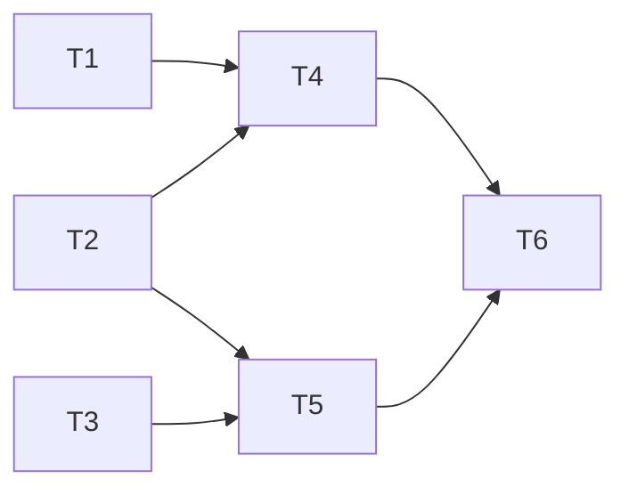

# 分析評測集規格

分支：`feature/analysis-eval-set`
狀態：已確認（2026-11-01，待確認事項 1～14 全部依照建議；案例錄音已完成）

這份文件定義一套在本機執行的「分析評測集」：用固定的會議逐字稿和預期結果，重複呼叫跟正式環境同一份 prompt 和 schema，用程式檢查輸出、產出報告。目的是之後改 prompt 或換模型（評估 Haiku 5.5）時，能用數字判斷變好還是變差，不再只靠一次實機手動看。這是 2026-10-30 定案路線的第 ③ 步（見 Obsidian 的 D4），需求在 2026-11-01 用 12 題確認（全部依照建議）。

## 背景（2026-11-01 確認）

1. 案例來源：照稿錄的會議，加上 2～3 場使用者同意使用的真實會議。
2. 真實會議的逐字稿不進 git，放在 gitignore 的 `evals/private/`；照稿案例進 git。
3. 真實逐字稿的取得方式：用 Xcode 的 Devices 視窗下載 App 容器，取出 `history/<id>.json`。
4. 第一版 5～8 筆，涵蓋一般單場、接續上一場、自訂詞庫、個人筆記、長會議（30 分鐘以上）。
5. 在本機跑 node 腳本，共用 `functions/src/analyze.ts` 的 prompt 和 schema，直接呼叫 Anthropic API（不經 App Check、不算每日次數）。
6. API key 放在 gitignore 的 `functions/.env.local`，跟正式環境用不同的 key。
7. 評分：程式檢查「必須出現／不可出現／待辦狀態／決議變化」，再產出對照報告給人工看；LLM 評分之後再說。
8. 評全部輸出：摘要、待辦、會議紀錄、`follow_up`、`highlight_contexts`。
9. 每筆跑 3 次，報告寫出每一項在 3 次中通過幾次。
10. 每輪費用上限 US$0.5，超過先停下來問。
11. 可以指定模型和 prompt 版本，報告記錄下來，可以跟上一輪比較。
12. 先不接 CI，手動執行。

## 現況（寫規格時查過的程式碼）

- `functions/src/analyze.ts`：`AnalyzeMeetingRequest`、`validateRequest`、`buildUserMessage`、`SYSTEM_PROMPT`、`outputSchema`，不依賴 Firebase，已經可以單獨匯入。
- `functions/src/index.ts:78-86`：`messages.create` 的參數寫在 onCall 裡（`model: "claude-haiku-4-5"`、`max_tokens: 6000`、`output_config.format`），評測腳本要跟它一模一樣，目前沒有共用的地方。
- `functions/`：TypeScript，`npm test` 用 `tsconfig.test.json` 編譯到 `build-test/` 再跑 `node --test`；Node 22；`@anthropic-ai/sdk` ^0.112.4。
- `firebase.json` 的 functions `ignore` 已經包含 `*.local`，`functions/.gitignore` 也有 `*.local`，所以 `functions/.env.local` 不會進 git，也不會被部署上傳。
- App 端組 request 的邏輯是 Dart：`buildHighlights`、`segmentIndexFor`（`lib/services/analysis_service.dart`，這個檔案 import 了 `cloud_functions`，不能用純 Dart 執行）、`previousChain`、`toPreviousMeetingPayload`（`lib/services/meeting_chain.dart`，純 Dart）。
- `history/<id>.json` 就是 `Recording.toJson()`：`segments`、`notes`、`analysis`、`previous_recording_id` 等。
- 第一筆案例的稿子和預期結果：`docs/specs/feature-cross-meeting-memory/acceptance-script.md`。

## 目標與範圍

1. **案例格式**：每筆案例一個資料夾，內含送給分析的 request（凍結，不再隨 App 資料變動）和預期結果。
2. **匯出工具**：用 Dart 寫（`tool/export_eval_case.dart`），把手機下載的 App 容器裡的 `history/<id>.json`（加上接續的前幾場、詞庫）轉成案例的 request，呼叫 App 同一批函式，跟 App 送出的完全一樣。每一場可以決定帶不帶詞庫（`--glossary` / 不帶），因為詞庫是全域的，C3 加的詞庫不該跟著 C1、C2、C4。
3. **評測腳本**：讀案例、每筆跑 N 次（預設 3）、用程式檢查、寫報告；可以指定模型、案例、次數、費用上限、比較的基準輪。
4. **共用參數**：評測和正式環境用同一個函式組 `messages.create` 的參數，避免兩邊不一致。
5. **第一版案例**：5 筆（C1～C5，見下方「第一版案例」），涵蓋背景第 4 點的五種情境。
6. **報告**：每一項檢查在 N 次中通過幾次、每筆的花費和 token 數、跟基準輪的差異；附上每次的原始輸出，方便人工看。

**明確不做的事**：

- 不用 LLM 評分（之後再說）。
- 不接 CI、不在部署前自動執行。
- 不改 App 的分析行為；只有 function 端抽出共用參數，線上行為不變。
- 不評轉錄（whisper）的品質，只評 Claude 的分析。
- 不做評測結果的畫面，報告是 Markdown。

## 第一版案例（2026-11-01 錄音完成）

| 代號 | App 裡的名稱 | 情境 | 放哪裡 | 稿子／預期結果 |
|---|---|---|---|---|
| C1 | 官網改版週會（第一場） | 一般單場 | `evals/cases/` | `docs/specs/feature-cross-meeting-memory/acceptance-script.md` |
| C2 | 官網改版週會（第二場，接續 C1） | 接續上一場 | `evals/cases/` | 同上 |
| C3 | 即時錄音 2026-11-01 13:11 | 自訂詞庫（轉錄後才加詞庫） | `evals/cases/` | [`recording-scripts.md`](recording-scripts.md) |
| C4 | 即時錄音 2026-11-01 12:33 | 個人筆記（含兩則陷阱筆記） | `evals/cases/` | 同上 |
| C5 | 分散式太陽光電推動策略與… | 長會議（真實） | `evals/private/` | 我先擬 `expect.json`，使用者確認 |

C6～C7（再 1～2 場真實會議）這一版不做。照稿案例的逐字稿用實機錄音轉出來的版本（決定 3），稿子放在 `README.md`。

## API 異動

`analyzeMeeting` 的對外行為不變。內部重構：

- `functions/src/analyze.ts` 新增 `ANALYSIS_MODEL = "claude-haiku-4-5"`、`ANALYSIS_MAX_TOKENS = 6000`，以及 `buildAnalysisParams(req, { model? })`，回傳 `messages.create` 的完整參數（`model`、`max_tokens`、`system`、`messages`、`output_config`）。
- `index.ts` 改呼叫 `buildAnalysisParams(data)`，評測腳本呼叫 `buildAnalysisParams(req, { model })`。
- `PROMPT_VERSION`：不手動維護，由 `SYSTEM_PROMPT` 加 `outputSchema` 的內容雜湊（取前 8 碼）自動算出，報告另外記錄 git commit。

### 評測腳本：`npm run eval`（在 `functions/` 執行）

- 參數：
  - `--model <id>`：預設 `ANALYSIS_MODEL`
  - `--cases <名稱,…>`：預設全部（含 `evals/private/` 底下存在的）
  - `--runs <n>`：預設 3
  - `--budget <美元>`：預設 0.5
  - `--baseline <輪次資料夾>`：預設上一輪
  - `--label <文字>`：寫進報告，方便辨識這一輪改了什麼
  - `--evals <資料夾>`：預設 App 根目錄的 `evals/`（測試或另一份案例集用）
  - `--yes`：沒有加時只估算、不送出；看過估算再加上 `--yes` 執行
- API key：讀 `functions/.env.local` 的 `EVAL_ANTHROPIC_API_KEY`（用 Node 22 的 `--env-file-if-exists`，檔案不存在時由腳本自己報「沒有 key」）。變數名稱刻意跟正式環境的 secret `ANTHROPIC_API_KEY` 不同，避免 Firebase 模擬器把兩者混在一起。
- 執行前先估算這一輪的費用（見邊界案例），超過 `--budget` 就停下來，列出估算，不送出任何請求。
- 依序執行，不並行；每次呼叫的 `stop_reason`、`usage`、耗時都記錄下來。
- user message 加上 `cache_control`（prompt 快取），同一筆的第 2～N 次讀快取；其他參數跟正式環境一樣。
- 基準輪在送出第一個請求之前就讀好：`--baseline` 指定的輪次不存在時直接報錯，不花錢。
- 錯誤：key 沒設定、案例格式錯誤、request 沒通過 `validateRequest` → 開跑前就失敗，不花錢。單次呼叫失敗（SDK 重試後仍失敗）→ 那一次記為失敗，繼續跑其他的。

## 資料表異動

無資料庫異動。新增檔案格式：

### 案例：`evals/cases/<案例名>/`（照稿，進 git）、`evals/private/<案例名>/`（真實，不進 git）

- `request.json`：`AnalyzeMeetingRequest`，就是 App 當時會送出的內容（`segments`、`glossary`、`highlights`、`previous_meetings`）。
- `expect.json`：預期結果，格式如下（每一項都是選填）：

```jsonc
{
  "description": "這筆案例在測什麼",
  "must_include": [
    // 在指定欄位裡，any_of 任一個詞出現就算通過
    { "id": "延期", "in": ["summary", "structured_minutes"], "any_of": ["11 月 22", "11/22", "十一月二十二"] }
  ],
  "must_not_include": [
    // 在指定欄位裡，任一個詞出現就算失敗（陷阱）
    { "id": "Meetup 陷阱", "in": ["summary", "todos", "structured_minutes"], "terms": ["Meetup", "贊助"] }
  ],
  "todos": [
    // 這次的待辦裡，要有一筆 task 包含 any_of 任一個詞；owner 選填
    { "id": "FAQ 草稿", "any_of": ["FAQ", "常見問題"], "owner_any_of": ["小華"] }
  ],
  "todo_progress": [
    // previous_todo_index 對應的狀態
    { "id": "文案完成", "previous_todo_index": 0, "status": "done" }
  ],
  "decision_changes": [
    // previous_decision 包含 any_of 任一個詞的那筆，change 要符合
    { "id": "主色推翻", "previous_any_of": ["藍"], "change": "reversed" }
  ],
  "new_topics": [{ "id": "FAQ", "any_of": ["FAQ", "常見問題"] }],
  "highlight_contexts": { "count": 2 }
}
```

- 欄位代號對應：`summary` ＝ overview＋key_points；`todos` ＝ task＋owner＋due_date；`structured_minutes` ＝ title＋attendees＋agenda_items 全部文字；`follow_up`；`highlight_contexts`。
- `README.md`（選填）：照稿案例附上稿子或稿子的連結。

### 每筆案例都自動加的通用檢查

- 回傳是合法 JSON，而且通過 schema（必填欄位都在）。
- `stop_reason` 不是 `max_tokens`（沒有被截斷）。
- 所有 `source_segment_index` 都在逐字稿範圍內（或 null）。
- 所有 `previous_todo_index` 都在 `previous_meetings` 最後一場的待辦範圍內。
- 輸出沒有簡體字（用常見簡繁對照字的小清單檢查）。

### 評測結果：`evals/runs/<YYYYMMDD-HHmm>_<model>/`（不進 git；時間是執行者的本機時間）

- `run.json`：模型、PROMPT_VERSION、git commit、label、每次呼叫的原始輸出、usage、耗時、每項檢查的結果。
- `report.md`：
  - 開頭：模型、prompt 版本、總花費、總體通過率、這一輪的註記（例如沒有 `evals/private/`）、跟基準輪的比較（哪幾項變好、變差，新增或移除的案例和檢查）。
  - 每筆案例：每項檢查「N 次中通過幾次」，失敗的列出實際內容。呼叫失敗（API 錯誤）的那一次不算進分母，另外列出「幾次呼叫失敗」和錯誤訊息。
  - 附錄：每次的完整輸出（JSON），方便人工比對。

## 權限與狀態機

無。

## UI／畫面

無（報告是 Markdown 檔）。

## 邊界案例與例外處理

- **費用估算**：用 `messages.countTokens` 算每筆的輸入 token（要帶 `output_config`，schema 約占 2,600 token），輸出以典型值 3000 token 估算，乘上次數和模型單價（含快取寫入、讀取）；用這個估算判斷有沒有超過 `--budget`。每次都寫滿 `max_tokens` 的最壞情況只列出來給人看，不拿來擋（照最壞情況，5 筆 × 3 次就超過 US$0.5）。單價寫在 `functions/eval/pricing.ts` 的價格表裡。
- **實際花費超過上限**（估算偏低時）：每次呼叫後累加實際花費，超過 `--budget` 就停在那裡，報告標示「未跑完」。
- **模型不支援結構化輸出或參數**（例如之後換模型）：那一次記為失敗，錯誤訊息寫進報告。
- **SDK 重試後仍然 429 或 5xx**：那一次記為失敗，繼續跑。
- **`evals/private/` 不存在或是空的**：只跑照稿案例，報告註明。
- **基準輪不存在、或案例不同**：只比較共同的案例和檢查項目，其他的標成「新增」或「已移除」。
- **案例的 request 沒通過 `validateRequest`**（例如 prompt 規則改了長度上限）：開跑前列出來，不花錢。
- **長會議超過模型的輸入上限**：目前的模型不會遇到；遇到時那一次記為失敗。

## 測試接縫

- **純函式**（`node:test`，沿用 `functions/test/`）：
  - `buildAnalysisParams`：預設模型和 `max_tokens` 跟現在的線上參數一致；可以覆寫模型。
  - `promptVersion()`：內容不變時雜湊不變；改一個字就變。
  - 檢查器 `gradeOutput(output, request, expect)`：每種檢查各有通過和失敗的例子（用手寫的假輸出，不呼叫 API）。
  - 費用估算 `estimateCaseCost(model, inputTokens, runs, outputTokens)`、報告比較 `compareRuns(current, baseline)`、基準輪 `loadBaseline(runsDir, named, except)`。
- **匯出工具**：直接呼叫 App 的 `buildHighlights`、`previousChain`、`toPreviousMeetingPayload`，所以只測轉檔本身：給一份假的容器資料夾，輸出的 `request.json` 欄位正確、帶不帶詞庫依參數、接續的前幾場正確凍結。
- **手動**：第一輪實際跑一次，人工看報告的附錄，確認檢查結果跟自己讀的判斷一致。

---

## 任務拆解

2026-11-01 初版：依本規格和 `functions/src/analyze.ts`、`functions/src/index.ts`、`lib/services/analysis_service.dart`、`lib/services/meeting_chain.dart` 的現況拆分。

**第一批可以開工**：T1、T2、T3（不改同一檔案，可以同時做）
**建議做法**：implement，依序做（共 6 張，符合並行門檻，但前三張份量小，依序做比較省）



- [x] **T1 正式環境和評測共用同一組參數**
  - 做完能看到：`buildAnalysisParams()`、`promptVersion()` 有測試；`index.ts` 改呼叫它，線上行為不變。
  - 被誰卡住：無，可以直接開工
  - 主要會動的檔案：`functions/src/analyze.ts`、`functions/src/index.ts`、`functions/test/analyze.test.ts`
  - 軌道：可獨立進行
  - 驗收：
    - [x] 預設模型 `claude-haiku-4-5`、`max_tokens` 6000、system、messages、`output_config` 跟改動前一致
    - [x] 可以覆寫模型
    - [x] `promptVersion()` 內容不變時相同、改一個字就變
    - [x] `npm test`、`npm run build` 通過（不部署，決定 14）
  - 備註：另外匯出 `promptHash(system, schema)`，讓「改一個字就變」可以測。

- [x] **T2 評分程式**
  - 做完能看到：用手寫的假輸出，`gradeOutput(output, request, expect)` 對每一種檢查都給出正確的通過／失敗。
  - 被誰卡住：無，可以直接開工
  - 主要會動的檔案：`functions/eval/grade.ts`、`functions/test/grade.test.ts`、`functions/tsconfig.test.json`
  - 軌道：可獨立進行
  - 驗收：
    - [x] `must_include`、`must_not_include`、`todos`、`todo_progress`、`decision_changes`、`new_topics`、`highlight_contexts` 各有通過和失敗的例子
    - [x] 通用檢查：schema 必填欄位、沒有被截斷、序號在範圍內、`previous_todo_index` 在範圍內、簡體字
    - [x] 欄位代號對應正確（例如 `summary` 包含 overview 和 key_points）
  - 備註：`functions/eval/grade.ts`，測試 `functions/test/grade.test.ts`（6 個）。`tsconfig.test.json` 加上 `eval`。

- [x] **T3 匯出工具**
  - 做完能看到：`dart run tool/export_eval_case.dart` 把 App 容器裡的一場會議轉成 `request.json`，依參數帶不帶詞庫，接續的前幾場凍結在檔案裡。
  - 被誰卡住：無，可以直接開工
  - 主要會動的檔案：`lib/services/analysis_service.dart`、新的純 Dart 檔（`buildHighlights`、`segmentIndexFor`）、`tool/export_eval_case.dart`、`test/`
  - 軌道：可獨立進行
  - 驗收：
    - [x] 前置重構後 `flutter test` 全部通過
    - [x] 用假的容器資料夾測試：欄位正確、帶不帶詞庫、接續的前幾場、找不到會議時的錯誤訊息
    - [x] 用名稱（標題或錄音名稱）或 id 都能指定會議
  - 備註：前置重構比規格多走一步：整個組 request 的邏輯（`buildAnalysisRequest`，含 `buildHighlights`、`segmentIndexFor`）搬到純 Dart 的 `lib/services/analysis_request.dart`，App 的 `AnalysisService.analyze` 和匯出工具都呼叫它，`analysis_service.dart` 再 export 它，既有 import 不用改。測試 `test/tool/export_eval_case_test.dart`（5 個）。

- [x] **T4 評測腳本與報告**
  - 做完能看到：`npm run eval` 會先估算費用，超過上限就停；每筆跑 N 次（同一筆的逐字稿用快取）；寫出 `run.json`、`report.md`，並跟基準輪比較。
  - 被誰卡住：T1、T2
  - 主要會動的檔案：`functions/eval/`、`functions/package.json`、`.gitignore`
  - 軌道：可獨立進行
  - 驗收：
    - [x] `estimateCost`、`compareRuns` 有測試（價格表用官方最新價格查證）
    - [x] 沒有 key、案例格式錯誤、request 沒通過驗證時，開跑前就失敗
    - [x] 報告標出 `expect.json` 被修改過的案例
    - [x] `.gitignore` 加上 `evals/private/`、`evals/runs/`
  - 備註：
    - 模組：`eval/pricing.ts`（價格表、單次花費、估算）、`eval/cases.ts`（讀案例、`expect.json` 雜湊）、`eval/report.ts`（通過次數、跟基準輪比較、Markdown 報告）、`eval/run.ts`（CLI）。測試 `functions/test/eval.test.ts`（8 個）。
    - 單價（2026-11-01 用 claude-api skill 查證）：Haiku 4.5 輸入 $1、輸出 $5／百萬 token，快取寫入 1.25 倍、讀取 0.1 倍，**最低 4096 token 才會快取**，所以只有長會議（C5）會用到快取；Haiku 5.5 為 $0.10／$0.50，最低 512 token。
    - 估算以每次輸出 3000 token 計算（典型值），同時列出每次都寫滿 `max_tokens` 的最壞情況；照最壞情況估，5 筆 × 3 次就會超過 US$0.5，等於永遠跑不了。實際花費每次呼叫前檢查，達到上限就停。
    - 比規格多一步：沒有加 `--yes` 時只估算、不送出，讓使用者先看估算（T6 的驗收條件）。
    - 給第 ⑤ 步的提醒：Haiku 5.5 預設開 thinking（effort 預設 medium），thinking 會吃 `max_tokens`，換模型時要另外評估 `max_tokens` 和 thinking 設定。

- [x] **T5 建立 C1～C5 案例**
  - 做完能看到：5 個案例資料夾都有 `request.json`、`expect.json`（C5 經使用者確認）、`README.md`。
  - 被誰卡住：T2（`expect.json` 的格式）、T3
  - 主要會動的檔案：`evals/cases/`、`evals/private/`
  - 軌道：需要使用者配合（用 Xcode 下載 App 容器、確認 C5 的預期結果）
  - 驗收：
    - [x] C3 帶詞庫，其他不帶
    - [x] C2 的 `previous_meetings` 有 C1 的結論
    - [x] C4 的 `highlights` 有 3 筆
    - [x] C5 只在 `evals/private/`，`git status` 看不到
  - 備註：容器 `com.example.echonote 2026-11-01 13:41.35.797.xcappdata`。案例資料夾：`c1-website-weekly`、`c2-website-weekly-followup`、`c3-tech-stack-glossary`、`c4-team-trip-notes`（`evals/cases/`）、`c5-solar-policy-long`（`evals/private/`）。C5 逐字稿第 41 段是 whisper 把詞庫 prompt 誤轉成逐字稿（Flutter、PostureCheck…），加成 C5 的陷阱。C5 的 `expect.json` 使用者同意先照草稿跑（2026-11-01）。

- [x] **T6 第一輪實際評測**
  - 做完能看到：一份真實報告；使用者看附錄的原始輸出，確認程式評分跟自己的判斷一致。
  - 被誰卡住：T4、T5
  - 主要會動的檔案：視需要修正 `expect.json` 或評分程式
  - 軌道：需要使用者配合（開跑前確認費用估算、看報告）
  - 驗收：
    - [x] 開跑前把估算給使用者看，同意後才送出
    - [x] 實際花費在 US$0.5 以內（US$0.136）
    - [x] 程式評分跟人工判斷不一致的地方都已處理（修 `expect.json` 或評分程式）：只有 C5「光電」太嚴，已放寬；使用者看過附錄，其他評分「差不多」一致（2026-11-01）

## 決定（2026-11-01 確認，全部依照建議）

1. 位置：案例放 App 根目錄的 `evals/cases/`、`evals/private/`，結果放 `evals/runs/`；腳本放 `functions/eval/`。`.gitignore` 加上 `evals/private/`、`evals/runs/`。
2. 匯出工具用 Dart（`tool/export_eval_case.dart`），呼叫 App 同一批函式。前置重構：把 `buildHighlights`、`segmentIndexFor` 從 `analysis_service.dart` 搬到不依賴 Flutter 外掛的檔案。
3. 照稿案例用實機錄音轉出來的逐字稿；稿子另外放 `README.md`。
4. 錄音：全部實機；C1～C5 已錄好（見「第一版案例」），C6～C7 這一版不做。詞庫依每一場決定帶不帶。
5. 費用：同一筆的 N 次用 prompt caching 快取；單價實作時用官方最新價格表查證；開跑前估算超過 `--budget` 就停下來問。
6. 真實會議的 `expect.json` 由我先擬，使用者確認後才算定案。
7. 新稿子：C3（詞庫）、C4（個人筆記，含兩則陷阱筆記），見 `recording-scripts.md`。
8. 溫度不設，跟正式環境一樣。
9. 保留「通過 schema」檢查。
10. 接續案例的 `previous_meetings` 凍結在匯出當下的版本。
11. 簡體字檢查只列約 20 個明確的簡體字，誤判時再調整。
12. `evals/runs/` 不進 git 就夠；要分享時只分享照稿案例的部分。
13. `any_of` 多列幾種說法；修改 `expect.json` 時，報告標出「檢查本身被修改過」（用 `expect.json` 的內容雜湊判斷）。
14. `index.ts` 抽出共用參數後，等下一次有實際改動時再一起部署；部署前先問。

## 評測紀錄

### 2026-11-01 第一輪基準（`20261101-0554_claude-haiku-4-5`，prompt `52d3aa9b`，commit `eab4510`）

- 整體通過率 98%（234/240 項次），花費 US$0.136（估算 US$0.264）。
- 沒通過的項目：
  - **C4 筆記被寫成會議內容（2/3 次）**：使用者筆記「民宿要問能不能帶寵物」被寫進待辦（「尋找民宿並詢問是否可帶寵物」）、摘要重點和會議紀錄的決議。另一則跟逐字稿矛盾的筆記「決定改去花蓮」三次都沒有被寫進去。→ prompt 的問題：筆記內容像是會議裡的待辦補充時，規則擋不住。
  - **C4 AI 補充說明少了（1/3 次）**：3 則筆記只回了 1 筆。→ prompt 的問題。
  - **C2 新主題漏了「預算」（1/3 次）**：模型不穩定。
  - **C5 摘要沒有「光電」（2/3 次）**：摘要寫的是「太陽能發電」「分散式發電設備」，意思正確，是 `expect.json` 太嚴。
- 評測工具本身的修正：
  - `countTokens` 原本沒有帶 `output_config`，漏算了 schema 約 2,600 token（C1 估 1,976、實際 4,599）。加上之後估算跟實際一致；而且短案例也因此超過 Haiku 4.5 的 4,096 token 快取門檻，第 2、3 次都讀到快取。
  - 輪次資料夾原本用 UTC 時間命名，改成本機時間。
- 處理（使用者 2026-11-01 確認）：
  - C5 的檢查改成「光電或太陽能」（`any_of` 加上「太陽能」），並拿掉說明裡的「草稿」字樣，`expect.json` 定案。下一輪報告會標出 C5「檢查本身被修改過」。
  - C4 的兩個 prompt 問題不在這個分支修：這個分支的範圍是建立評測集，不改分析行為。合併後另開 `fix/notes-leak`，以這一輪為基準，用評測集比對修改前後；修好的 prompt 要部署，部署前先問使用者。
  - C2 的「預算」是模型不穩定，檢查不改，之後的輪次繼續觀察。

## 驗收核對記錄

### 2026-11-01（`/spec-check`，commit `4e913e2`）

- 結論：主要功能都跟規格一致（共用參數、評分程式、匯出工具、案例、估算與費用上限、報告、gitignore）。有 3 項實作沒照規格做、3 項是規格沒跟上實作，等使用者決定怎麼處理。
- 落差：
  1. 指定的 `--baseline` 不存在時，腳本在**跑完、花完錢之後**才丟錯，`run.json` 和報告都不會寫出來（`functions/eval/run.ts` 讀 baseline 的那段）。規格寫的是「基準輪不存在 → 只比較共同的部分」。
  2. 跟基準輪比較時，只有「案例」會標新增／已移除，「檢查項目」新增或改名會直接略過（`compareRuns`，`functions/eval/report.ts`）。規格寫的是案例和檢查項目都要標。C5 的「光電」改名成「光電或太陽能」，下一輪就會碰到這種情況。
  3. 沒有 `evals/private/` 時，只印在終端機，報告裡沒有寫（規格：報告註明）。
  4. 規格的邊界案例寫「用 `max_tokens` 估最壞情況」來判斷有沒有超過上限，實作是用典型輸出 3000 token 判斷、最壞情況只列出來（T4 備註已寫原因）。這是規格沒跟上。
  5. 規格寫 `estimateCost(tokens, runs, model)`，實作是 `estimateCaseCost(model, inputTokens, runs, outputTokens)`。這是規格沒跟上。
  6. 呼叫失敗的那一次不算進「N 次中通過幾次」的分母（`passCounts`，有測試），報告另外列「幾次呼叫失敗」。規格寫「3 次中通過幾次」，沒有講失敗的那一次怎麼算。
- 規格未涵蓋：`--yes`（T4 備註已寫）、`--evals`、user message 加 `cache_control`、輪次資料夾用本機時間、附錄放整份輸出（規格只寫摘要、待辦、`follow_up`）、`--env-file-if-exists`（規格寫 `--env-file`）。
- 處理（使用者 2026-11-01 確認，依照建議）：
  - 落差 1～3 改實作：基準輪改在送出前用 `loadBaseline` 讀，指定的不存在就直接報錯；`compareRuns` 加上新增／已移除的檢查（`addedChecks`、`removedChecks`），報告列出來；`RunRecord.notes` 記錄「沒有 evals/private/」並寫進報告開頭。新增 3 個測試，functions 共 29 個測試通過。
  - 落差 4～6 和規格未涵蓋的項目改規格：已更新「評測腳本」「評測結果」「邊界案例」「測試接縫」。
