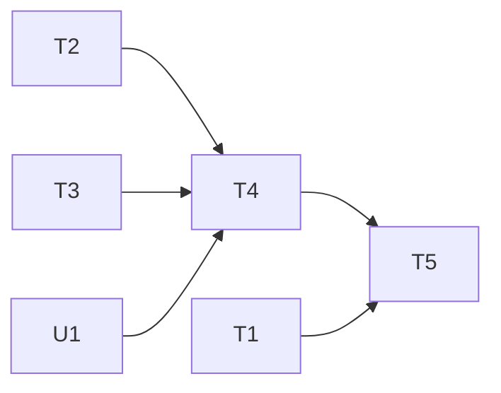

# 分析服務防盜用（App Check＋呼叫上限）規格

分支：`feature/app-check`
狀態：已確認（2026-10-30，17 項待確認事項全部採用建議；同日因為只有免費 Personal Team，改用 debug provider，見決定 10、18）

這份文件讓 Cloud Function `analyzeMeeting` 只接受「從真的 EchoNote App 發出」的呼叫，並替呼叫次數設上限，避免拿到 Firebase 設定檔的人直接打這支 function、用掉 Anthropic 額度。起因是 2026-10-30 討論 Anthropic 開源的資安參考範本（defending-code-reference-harness）時，回頭檢查 echonote 發現的風險。

## 背景（2026-10-30 討論）

- Anthropic 的 API 金鑰放在 Firebase Secret Manager，App 不會拿到金鑰。但 function 本身任何人都能呼叫，等於別人可以借用這把金鑰。
- 呼叫 function 需要的資訊（專案 ID、API key、App ID）都在 `ios/Runner/GoogleService-Info.plist` 和 `lib/firebase_options.dart`。這兩個檔案在 git 裡；echo_core 公開前已經決定「之後再搬出 git」。就算搬出去，這些值也能從 App 安裝檔裡拆出來，所以**搬檔案不能代替驗證呼叫者**。
- 這次討論的優先順序：先做這份（防盜用），之後才做跨會議記憶和分析評測集。

## 現況（寫規格時查過的程式碼）

- `functions/src/index.ts:14`：`onCall({ secrets, timeoutSeconds: 120, memory: "256MiB" })`，沒有檢查 `request.auth`、沒有 App Check、沒有 `maxInstances`。只用 `validateRequest()` 檢查格式。
- 模型 `claude-haiku-4-5`，`max_tokens: 4096`；每場會議分析約 US$0.01～0.02。
- `lib/main.dart`：只呼叫 `Firebase.initializeApp`；在 Android 上會丟出 `UnsupportedError`，`AnalysisService.available` 維持 false。
- `lib/services/analysis_service.dart:20`：`FirebaseFunctions.instance.httpsCallable('analyzeMeeting')`。
- `lib/screens/meeting_detail_screen.dart:113-115`：任何錯誤都顯示 `分析失敗: $e`，沒有依錯誤種類給訊息。
- `pubspec.yaml`：`firebase_core ^4.12.1`、`cloud_functions ^6.3.5`；還沒有 `firebase_app_check`。
- iOS 最低版本 15.6（App Attest 需要 iOS 14 以上，符合）。`ios/Runner/` 沒有 `.entitlements` 檔，App Attest 需要新增。
- 專案沒用 Firestore；`functions/` 沒有測試框架。
- 實作時另外做的修改（2026-10-31 spec-check 補記）：Cloud Functions 執行環境 Node.js 20 → 22（20 在 2026-10-30 停用）；`firebase_app_check` 0.4.9 帶動 `firebase_core` 4.15.2，所以 `cloud_functions` 升到 6.5.1 並 `pod update`；新增 `app_check.local.json.example`；`functions/tsconfig.test.json` 把測試編譯到 `build-test/`（不進 git、不部署）。

## 目標與範圍

1. **App 端啟用 App Check**：加入 `firebase_app_check`，在 `Firebase.initializeApp` 之後啟用。
   - 所有 build（Debug／Profile／Release、實機和模擬器）都用 **debug provider**。原因：目前用 Xcode 免費的 Personal Team 安裝，沒有付費 Apple Developer Program，App Attest 無法使用；近期也沒有上架計畫（決定 18）。
   - debug token 用 `--dart-define=APP_CHECK_DEBUG_TOKEN=<token>` 在建置時帶入，值放在不進 git 的本機檔案；所有自己的裝置共用同一個 token，在 Firebase Console 登記一次，重新安裝 App 也不用重新登記。
   - 沒帶 token 建置時，退回 debug provider 自動產生的 token（印在 Xcode console），要另外登記。
   - 之後要上架時，再改成 App Attest（加 entitlement、App ID 開啟 App Attest），另開分支處理。
2. **Function 端強制檢查**：`analyzeMeeting` 加上 `enforceAppCheck: true`。沒有合法 App Check token 的呼叫，在呼叫 Claude 之前就被拒絕。
3. **同時執行的實例上限**：`maxInstances: 3`，限制短時間內被大量呼叫時的最大花費速度。
4. **每日呼叫上限**：全域（不分裝置）每天 50 次，以 Asia/Taipei 日期切換，用 Firestore 計數。超過上限就回 `resource-exhausted`，不呼叫 Claude。
5. **App 端錯誤訊息分類**：依 `FirebaseFunctionsException.code` 給不同的中文訊息（見 UI 章節），取代現在的 `分析失敗: $e`。
6. **Anthropic Console 花費上限**（你手動設定）：每月上限 US$10，用量到 50% 時通知，當最後一道防線。

**明確不做的事**：

- 不把 `GoogleService-Info.plist`、`firebase_options.dart` 搬出 git（維持之前的決定，另外處理）。
- 不做使用者帳號登入（Firebase Auth 的 email／Apple 登入）。
- 不做每台裝置分開計數、不加 Firebase 匿名登入（決定 2）。
- 不開 `consumeAppCheckToken`（決定 15）。
- 不做 App Attest／DeviceCheck（決定 18，等有付費帳號、要上架時再做）。
- 不做 Android（Android 還沒設定 Firebase；之後做 Android 時再加 Play Integrity）。
- 不改分析的 prompt、模型、輸出格式。
- 不做付費方案或依使用者分級的額度。

## API 異動

### `onCall analyzeMeeting`

- 異動內容：加 `enforceAppCheck: true`、`maxInstances`；呼叫 Claude 之前先檢查並增加每日計數。
- Request：不變（`segments`、`glossary?`、`highlights?`）。
- Response（成功）：不變。
- 新增的錯誤情境：

| 情境 | 錯誤碼 | 由誰丟出 |
|---|---|---|
| 沒有 App Check token 或 token 不合法 | `unauthenticated` | Firebase 框架（`enforceAppCheck`） |
| 超過每日上限 | `resource-exhausted` | 我們的程式 |
| 計數存取失敗（例如 Firestore 暫時無法使用） | `unavailable`（拒絕，不呼叫 Claude） | 我們的程式 |

- 既有的 `resource-exhausted`（Claude API 回 429）訊息維持不變。每日上限的錯誤在 `details` 放 `{ reason: "daily_quota" }`，App 端依此區分兩者。

## 資料表異動

在 `echonote-64428` 開啟 Firestore（區域 `asia-east1`，選定後不能改，由你在 Console 操作）。結構：

- 集合 `usage_daily`，文件 ID `<YYYY-MM-DD>`（Asia/Taipei 日期）。
- 欄位 `count: number`、`updatedAt: timestamp`、`expireAt: timestamp`（建立時間 + 30 天）。
- 以 Firestore transaction 讀取並加一，避免同時呼叫時算錯。
- 舊文件不需要遷移；在 Console 對 `usage_daily.expireAt` 設 TTL 政策，30 天後自動清除。
- Firestore 安全規則：App 端不需要直接讀寫，規則設成全部拒絕，只有 function（Admin SDK）能寫。

## 權限與狀態機

- 角色只有一種：「通過 App Check 的 App」。沒有登入，也沒有使用者分級。
- 呼叫流程：
  1. App Check 檢查（框架處理）→ 不通過就回 `unauthenticated`。
  2. `validateRequest()` 檢查格式 → 不通過就回 `invalid-argument`。
  3. 每日計數檢查並加一 → 超過就回 `resource-exhausted`。
  4. 呼叫 Claude。
- 格式錯誤的呼叫不算進次數（先檢查格式再計數）。

## UI／畫面

不新增畫面，只改 `MeetingDetailScreen` 分析失敗時的 SnackBar 文字。文字是暫定的：

| 錯誤碼 | 暫定文字 |
|---|---|
| `unauthenticated` | 無法驗證這個 App，請確認使用的是正式版本，或稍後再試 |
| `resource-exhausted`（每日上限） | 今天的分析次數已用完，明天再試 |
| `resource-exhausted`（Claude 額度） | 維持現在的「Claude API 額度已達上限，請稍後再試」 |
| `unavailable` | 網路連線有問題，請稍後再試 |
| `unknown`（iOS 斷網、逾時等網路錯誤） | 網路連線有問題，請稍後再試（<iOS 原始訊息>） |
| 其他 | 分析失敗：<function 回傳的 message> |
| 不是 Firebase 丟出的錯誤 | 分析失敗：<錯誤內容> |

## 邊界案例與例外處理

- **Debug 版本沒登記 debug token**：會得到 `unauthenticated`。console 會印出 debug token，要把登記步驟寫進 README 或 devlog。
- **debug token 外洩**：等於任何人都能通過 App Check，只剩每日上限擋著。token 不進 git；外洩時到 Console 刪掉舊 token、換新的。
- **建置時忘了帶 `--dart-define`**：App 會用自動產生的 token，沒登記就會被擋，訊息是 `unauthenticated`。要把建置指令寫進 README。
- **SDK 印出的 debug token 不一定是實際送出的那個**：就算帶了 `--dart-define`，iOS SDK 啟動時仍會印出自己產生、存在手機上的 token（2026-10-30 實測）。判斷有沒有生效要看 function 是否放行，不要看這行 log。
- **已經安裝在手機上的舊版 App**（沒有 App Check）：部署後就無法分析，必須重新安裝新版。目前只有開發者自己的裝置，可以接受；部署順序：先部署只記錄、不擋的版本（`enforceAppCheck: false`，在 log 印出 `request.app` 是否存在），實機確認有 token 之後再改成強制。
- **計數增加了但 Claude 呼叫失敗**：不退回計數。
- **跨日**：計數依日期切換，換日後自動從 0 開始。
- **同一台裝置同時發出多次呼叫**：transaction 保證計數正確。

## 測試接縫

- **Function 端的計數判斷**：把「讀目前次數 → 判斷是否超過 → 決定要不要加一」抽成純函式（例如 `decideQuota(current, limit)`），不依賴 Firestore，可以單元測試。Firestore transaction 本身用 emulator 手動驗證，或不寫自動化測試。
  - `functions/` 用 Node 內建 `node:test`，`tsc` 編譯後執行，不另外安裝套件。
- **App 端錯誤訊息對照**：把「`FirebaseFunctionsException` → 中文訊息」抽成 `lib/services/` 裡的純函式，單元測試每個錯誤碼。
- **App Check 是否真的生效**：無法用單元測試，用手動驗收：
  1. 用 `curl` 不帶 App Check token 直接呼叫 function，預期得到 401／`unauthenticated`。
  2. 用實機 Profile 版本（帶 `--dart-define` token）分析一場會議，預期成功。
  3. 在 Console 暫時刪掉 debug token，實機分析預期被擋（`unauthenticated`）；再登記回去，預期恢復。（2026-10-30 改：`ffmpeg_kit_flutter_new_min` 不支援 arm64 模擬器，改用實機驗證）
  4. 在 Firebase Console 把今天的 `usage_daily/<日期>.count` 改成 50（不用重新部署），分析預期看到「今天的分析次數已用完」；測完改回原值。

---

## 任務拆解

2026-10-30 初版：依本規格（決定 1～18）與 `functions/src/index.ts`、`lib/main.dart`、`meeting_detail_screen.dart` 拆解。

**第一批可以開工**：T1、T2、T3、U1（不改同一檔案）
**建議做法**：implement，在同一個對話依序做（共 6 張，達並行門檻，但 T1～T3 都很小，並行反而慢）

- [x] **T1 分析失敗時依錯誤種類顯示訊息**
  - 做完能看到：每日上限、App 驗證失敗、斷網、Claude 額度各自顯示 UI 章節的中文訊息
  - 被誰卡住：無，可以直接開工
  - 主要會動的檔案：`lib/services/analysis_errors.dart`（新）、`lib/screens/meeting_detail_screen.dart`、`test/services/analysis_errors_test.dart`（新）
  - 軌道：可獨立進行
  - 驗收：
    - [x] 每個錯誤碼（含 `details.reason == "daily_quota"`）都有單元測試
    - [x] `flutter test`、`flutter analyze` 通過

- [x] **T2 Function 加上每日上限和實例上限**
  - 做完能看到：超過每日 50 次回 `resource-exhausted`（`details.reason = "daily_quota"`）；計數失敗回 `unavailable`；格式錯誤不計數
  - 被誰卡住：無，可以直接開工（部署要等 U1）
  - 主要會動的檔案：`functions/src/quota.ts`（新）、`functions/src/index.ts`、`functions/package.json`、`functions/test/`（新）、`firestore.rules`（新）、`firebase.json`
  - 軌道：可獨立進行
  - 驗收：
    - [x] `decideQuota` 與 Asia/Taipei 日期 key 有 `node:test` 測試
    - [x] `npm run build`、`npm test` 通過
    - [x] `maxInstances: 3`；`firestore.rules` 全部拒絕
  - 2026-10-30 完成（未部署）。
    - `functions/src/quota.ts` 放純函式；Firestore transaction 在 `index.ts` 的 `consumeDailyQuota`。
    - 測試用獨立的 `tsconfig.test.json` 編譯到 `build-test/`（不進 git、不部署），`npm test` 跑 3 個測試。
    - `firebase.json` 加上 `firestore.rules`；部署規則要等 U1 開好 Firestore。
    - 計數失敗回 `unavailable`，App 端會顯示「網路連線有問題」，跟實際原因不完全一樣，可以接受。

- [x] **T3 App 端啟用 App Check（debug provider）**
  - 做完能看到：App 啟動後啟用 App Check，用 `--dart-define` 帶入的 debug token；沒帶時退回自動產生的 token
  - 被誰卡住：無，可以直接開工
  - 主要會動的檔案：`pubspec.yaml`、`lib/main.dart`、`.gitignore`、本機 token 檔（不進 git）、`README.md`
  - 軌道：可獨立進行
  - 驗收：
    - [x] `flutter analyze`、`flutter test`、`flutter build ios --no-codesign` 通過
    - [x] token 檔不在 `git status` 裡
  - 2026-10-30 完成（還沒上實機）。
    - `firebase_app_check` 0.4.9；`AppleDebugProvider(debugToken:)`，token 由 `String.fromEnvironment('APP_CHECK_DEBUG_TOKEN')` 讀取。
    - token 檔 `app_check.local.json`（gitignore），範本 `app_check.local.json.example`；`.vscode/launch.json` 三個設定都加上 `--dart-define-from-file`。
    - 坑：加套件把 `firebase_core` 升到 4.15.2（Firebase iOS SDK 12.19），但 `Podfile.lock` 還鎖著 `Firebase/Functions` 12.15.0，pod install 報「需要更高的最低 iOS 版本」，其實是版本互相衝突。修法：`flutter pub upgrade cloud_functions`（6.5.1）＋ `pod update Firebase FirebaseCore FirebaseFunctions --repo-update`，再刪掉 `build/ios` 清掉舊的 module 快取（`FLTFirebaseCorePlugin has different definitions`）。

- [x] **T4 部署只記錄、不擋的版本並到實機確認**
  - 做完能看到：function log 顯示實機和模擬器的呼叫都帶著 App Check token
  - 被誰卡住：T2、T3、U1
  - 主要會動的檔案：`functions/src/index.ts`
  - 軌道：可獨立進行（部署前先問使用者）
  - 驗收：
    - [x] 實機 Profile 分析一次，log 為 `App Check ok`（模擬器跳過，見測試接縫第 3 項）
  - 2026-10-30 完成。
    - 第一次部署失敗：Cloud Functions 的 Node.js 20 剛好在 2026-10-30 停用，`engines.node` 升到 22 後部署成功。
    - curl 不帶 token：log `App Check missing`，被格式檢查擋下（`INVALID_ARGUMENT`），沒有計數。
    - 實機 Profile：log `App Check ok`。啟動時 SDK 印出的「Firebase App Check debug token」跟 `app_check.local.json` 不同，那是 SDK 自己產生、存在手機上的值；實際送出的是 `--dart-define` 帶入的 token。這是推論，由 T5 強制後實機仍能分析來證實。

- [x] **T5 改成強制檢查並驗收**
  - 做完能看到：沒有 token 的呼叫被擋；自己的裝置照常分析；每日上限提示正確
  - 被誰卡住：T1、T4
  - 主要會動的檔案：`functions/src/index.ts`、本規格、`docs/devlogs/feature-app-check.md`（新）
  - 軌道：可獨立進行（部署前先問使用者）
  - 驗收：
    - [x] 測試接縫章節的手動驗收：1、2、4 通過，3 跳過（理由見下）
    - [ ] `/spec-check`、devlog 完成
  - 2026-10-31 驗收結果。
    - ① curl 不帶 token：`401 UNAUTHENTICATED`。
    - ② 實機 Profile 強制後照常分析。也證實 T4 的推論：送出的是 `--dart-define` 的 token（SDK 印出的那個從沒登記過）。
    - ③ 跳過：刪掉 debug token 後，手機上快取的 App Check token（約 1 小時有效）讓分析照常成功；這一項驗的是 Firebase 拒絕換發新 token 的行為，① 已經證明沒有 token 會被擋。token 之後用 `npx firebase-tools@latest appcheck:debugtokens:create` 登記回去（本機 firebase CLI 14.17 沒有這個指令）。
    - ④ 在 Console 把 `usage_daily/2026-10-31.count` 改成 50，實機看到「今天的分析次數已用完，明天再試」，之後改回。

- [x] **U1 Console 設定**
  - 做完能看到：Firestore（`asia-east1`）已開、`usage_daily.expireAt` 有 TTL；Firebase App Check 已登記 iOS App 與 debug token；Anthropic Console 每月上限 US$10、50% 通知
  - 被誰卡住：無，可以直接開工
  - 主要會動的檔案：無（Console 操作）
  - 軌道：需要使用者手動操作
  - 2026-10-30 完成：Firestore 選 Standard 版、`(default)`、`asia-east1`、正式版模式；TTL 在 Google Cloud Console 設定（Firebase Console 沒有這一頁）；App Check 不選提供者，直接在 App 的 ⋮ →「管理偵錯權杖」登記；Anthropic 上限在 Claude Console → 管理 → 支出限額 → 前往組織設定（Default 工作區的上限在組織層級管理）。

## 待確認事項

無。

## 已確認的決定（2026-10-30）

17 項全部採用建議：

1. `maxInstances: 3`。
2. 每日上限算全域，不分裝置，不加匿名登入。
3. 每天 50 次（約 US$1）。
4. 以 Asia/Taipei 日期切換。
5. 計數存取失敗時拒絕，回 `unavailable`。
6. 每日上限的錯誤在 `details` 放 `{ reason: "daily_quota" }`。
7. 計數文件 30 天後以 TTL 自動清除。
8. 格式錯誤的呼叫不計數。
9. 先部署只記錄、不擋的版本，實機確認後再強制。
10. ~~entitlements 依 build configuration 分開~~。2026-10-30 作廢：不用 App Attest，不需要 entitlements（見決定 18）。
11. Claude 呼叫失敗不退回計數。
12. `functions/` 測試用 `node:test`。
13. 使用 Firestore，區域 `asia-east1`。
14. Anthropic Console 設每月上限 US$10，用量到 50% 時通知。
15. 不開 `consumeAppCheckToken`。
16. Firebase Console、Anthropic Console 的設定由你操作，我提供步驟清單。
17. 每次 `firebase deploy` 前先問過你。
18. 只有免費 Personal Team、近期不上架：所有 build 都用 debug provider，共用一個以 `--dart-define` 帶入的 debug token；App Attest 等要上架時再做。

## 驗收核對記錄

### 2026-10-31

**結論**：功能面全部跟規格一致，手動驗收 ①②④ 通過、③ 有理由跳過。落差 3 項，都是規格文字沒跟上，不是實作錯誤；另有 1 項行為沒驗證到。

- ✅ 一致：`enforceAppCheck: true`、`maxInstances: 3`（`functions/src/index.ts:51-53`）；先檢查格式再計數（`:56-63`）；計數失敗回 `unavailable`（`:64-68`）；超過上限回 `resource-exhausted` 並帶 `daily_quota`（`:69-73`）；transaction 計數、`expireAt` 為 30 天後、失敗不退回（`:25-44`）；每天 50 次、Asia/Taipei 日期（`functions/src/quota.ts:6,9,15`）；`firestore.rules` 全部拒絕；App 端 debug provider 加上 `--dart-define` token（`lib/main.dart:22-25`）；錯誤訊息對照（`lib/services/analysis_errors.dart:10-23`，接到 `meeting_detail_screen.dart:116`）；README、`.gitignore`、`.vscode/launch.json` 都已更新。
- ⚠️ 落差（規格沒跟上）：
  1. 「目標與範圍」的編號順序寫成 1、2、3、4、6、5。
  2. 測試接縫第 4 項寫「把每日上限暫時調成 1」，實際驗收的做法是直接在 Console 把 `count` 改成 50，不用重新部署。
  3. 邊界案例寫「沒帶 `--dart-define` 時，SDK 會印出自動產生的 token」，但實測發現就算有帶，SDK 還是會印出它自己產生的那一個，容易讓人誤以為印出來的就是實際送出的 token。
- ❓ 規格未涵蓋：Cloud Functions 執行環境升到 Node.js 22；`cloud_functions` 升到 6.5.1 並更新 pods；`app_check.local.json.example`；`functions/tsconfig.test.json` 加上 `build-test/`；非 Firebase 錯誤顯示「分析失敗：<錯誤內容>」。
- ❓ 沒驗證到：斷網時 iOS 外掛實際回傳的錯誤碼是不是 `unavailable`。如果不是，會落到「分析失敗：…」，而不是「網路連線有問題」。
- 處理（2026-10-31）：三項落差都改規格配合實作；規格沒提到的修改補進「現況」和 UI 表格；斷網錯誤碼用實機飛航模式測試（結果見下一筆）。

### 2026-10-31（斷網測試）

- 實機飛航模式分析，顯示「分析失敗：the internet connection appears to be offline」。原因：iOS 外掛 `createFlutterError` 只轉換 `com.firebase.functions` domain 的錯誤，`NSURLErrorDomain` 一律變成 `unknown`，訊息是 iOS 的英文系統文字。規格原本假設是 `unavailable`，假設錯誤。
- 處理：`unknown` 也顯示網路訊息並附原文（`lib/services/analysis_errors.dart`），加單元測試；UI 表格拆成 `unavailable` 與 `unknown` 兩列。
- 順帶確認：function 的 `details` 經外掛 `additionalData` 原樣傳到 Dart（`cloud_functions_platform_interface` `exception.dart:37`），每日上限的判斷確實是靠 `details.reason`，不是剛好落到 message。
