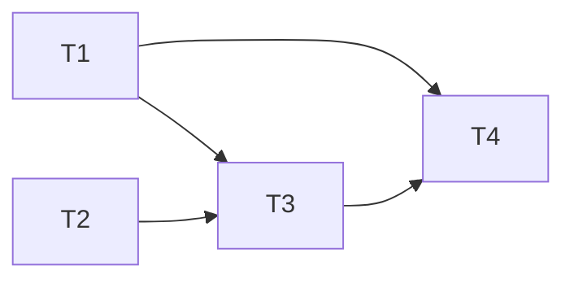

# 跨會議記憶（接續上一場會議）規格

分支：`feature/cross-meeting-memory`
狀態：已確認（2026-10-31，待確認事項 1～16 全部依照建議）

這份文件讓使用者把一場會議設定成「接續」之前的某一場。分析時把前幾場的結論一起交給 Claude，摘要多一段「與上次相比」：上次的待辦這次進展到哪、哪些決議被延續或推翻、這次新出現了什麼。起因是 2026-10-30 討論 Anthropic 的 knowledge-work-plugins（律師打 `/brief`，它告訴你「以前怎麼結論、這次改了什麼」），這跟 EchoNote 定位的「會議記憶」一致（見 `docs/devlogs/feature-user-context.md`）。

## 背景（2026-10-30 討論已定案）

- 由使用者**手動**選擇「接續哪一場」，不讓 App 自動猜。
- 只送前 **1～3 場**的結構化結論，**不送逐字稿**，成本可以控制。
- 做完這個功能之後，才做分析評測集，因為這次會大改 prompt。

## 現況（寫規格時查過的程式碼）

- `lib/models/recording.dart`：`Recording` 沒有跟其他場次的關聯；`MeetingAnalysis` 有 `overview`、`keyPoints`、`todos`（含使用者勾選的 `done`）、`title`、`attendees`、`agendaItems`（含 `decisions`）、`highlightContexts`。
- `lib/services/recording_store.dart`：每場一個 JSON 檔（`history/<id>.json`），`loadAll()` 依建立時間新到舊排序。
- `lib/services/analysis_service.dart`：`analyze(segments, glossary:, notes:)` 呼叫 `analyzeMeeting`。
- `functions/src/analyze.ts`：`validateRequest`、`buildUserMessage`（`<transcript>`、`<glossary>`、`<user_highlights>`，各自放在標籤裡）、`SYSTEM_PROMPT`、`outputSchema`（json_schema 結構化輸出）。
- `lib/screens/meeting_detail_screen.dart`：AppBar 有「重新分析」；摘要分頁上方是「你的重點」，下方是摘要卡片；`_runAnalysis()` 在 `:92`。
- `functions/src/index.ts`：已經有 App Check 和每日上限（feature/app-check），模型 `claude-haiku-4-5`，`max_tokens: 4096`。

## 目標與範圍

1. **設定接續**：在會議詳細頁選擇「接續哪一場」，只能選建立時間更早、而且已經分析過的場次；可以更換或取消。
2. **往前追溯**：分析時沿著接續關係往前找，最多 3 場（A ← B ← C ← 這場），只取有分析結果的場次。只有**最近一場**的待辦參與進度判斷，更早的場次只當背景（決定 3）。
3. **送出前幾場的結論**：每場送標題、日期、決議（`agendaItems[].decisions`）、待辦（含使用者勾選的完成狀態與 `owner`）、摘要 `overview`。不送逐字稿、不送使用者筆記、不送 `attendees`（決定 16），也不送前一場自己的 `follow_up`（決定 14）。
4. **新的分析輸出**：新增 `follow_up` 區塊（有前一場時才有內容）：
   - 上次待辦的進度：每一筆是「這次有提到已完成／有提到還在進行／這次沒提到」，附一句說明和逐字稿序號。「這次沒提到」也列出來，排在最後（決定 9）。
   - 決議的變化：延續、修改、推翻上次的哪個決議，附逐字稿序號。
   - 這次新出現的主題（上次沒有的）。
5. **畫面**：摘要分頁新增「與上次相比」卡片，點逐字稿序號可以跳到那一段播放。

**明確不做的事**：

- 不自動判斷同一系列（依標題、參與者、時間）。
- 不送前幾場的逐字稿和使用者筆記。
- 不做「系列」頁面或系列總覽。
- 不改變沒有設定接續的會議的分析結果（`follow_up` 為空）。
- 不做跨裝置同步，接續關係只存在本機。
- 不換模型（換模型等評測集做好再說）。
- 不做「修改會議日期」（決定 11，另外處理）。
- 前一場重新分析後，不主動提示接續它的場次（決定 12）。

## API 異動

### `onCall analyzeMeeting`

- Request 新增選填的 `previous_meetings`，由舊到新排列，最多 3 筆：

```ts
previous_meetings?: {
  title: string;
  date: string;            // YYYY-MM-DD，裝置當地日期，取自 createdAt（決定 5、11）
  overview: string;
  decisions: string[];     // 攤平各議程的 decisions
  todos: { task: string; owner: string | null; done: boolean }[];
}[]
```

- `validateRequest` 新增檢查：是陣列、最多 3 筆、各欄位型別正確、長度上限（決定 4）：
  - `overview` 最多 500 字
  - `decisions` 最多 20 筆、`todos` 最多 30 筆
  - 每筆決議、待辦的 `task`、`owner`、`title` 最多 200 字
  - App 端送出前先依同樣的數字截斷，所以正常情況不會被擋。
- `buildUserMessage` 新增 `<previous_meetings>` 標籤。每場標上序號；最後一場的待辦標成 `[上次待辦 i]`，讓輸出可以引用。
- `SYSTEM_PROMPT` 定義 `decision_changes` 的三種變化：continued 是重申、維持原決議（重申過的也一定要列）；revised 是方向不變、調整細節（日期、數量、範圍）；reversed 是取消原決議或改成另一個選項。第一次實機驗收時「主色藍 → 綠」被判成修改、延續漏列，2026-10-31 補上。
- `SYSTEM_PROMPT` 新增規則（決定 13）：`<previous_meetings>` 是之前會議的紀錄，**不是**這次的發言；`overview`、`key_points`、`todos`、`agenda_items` 等只能根據這次的逐字稿；`follow_up` 是唯一可以引用前幾場的欄位。
- `max_tokens` 從 4096 調到 6000（決定 8）。
- Response 新增 `follow_up`（schema 加入 `required`；沒有前一場時回傳空陣列）：

```ts
follow_up: {
  todo_progress: {
    previous_todo_index: number;   // <previous_meetings> 最後一場的待辦序號
    status: "done" | "in_progress" | "not_mentioned";
    note: string;                   // 50 字以內
    source_segment_index: number | null;
  }[];
  decision_changes: {
    change: "continued" | "revised" | "reversed";
    previous_decision: string;
    current: string;
    source_segment_index: number | null;
  }[];
  new_topics: string[];
}
```

- 錯誤情境：`previous_meetings` 格式錯誤 → `invalid-argument`（不計入每日次數，沿用 app-check 決定 8）。
- 部署順序（決定 15）：先部署 function（新欄位都是選填，舊版 App 不受影響），再上新版 App。部署前先問使用者。

## 資料表異動

本機 JSON（`history/<id>.json`）：

- `Recording` 新增 `previous_recording_id: String?`，預設 null；舊資料讀進來就是 null，不需要遷移。
- `MeetingAnalysis` 新增 `follow_up`（結構同上，但 `source_segment_index` 轉成 `source_timestamp_ms`，沿用既有「序號 → 時間」的本機查表；`previous_todo_index` 換成那筆待辦的文字 `task`）。舊資料沒有這個欄位時當成空的；空的 `follow_up` 不寫進檔案。
- 被接續的那場被刪除時（決定 6）：不改動接續它的那一場的 `previous_recording_id`；追溯時找不到就停止，畫面顯示「接續的會議已刪除」，可以重新選擇。

## 權限與狀態機

無角色區分。接續關係的規則：

- 只能接續建立時間更早的場次 → 天然不會形成循環。
- 往前追溯時遇到「找不到（已刪除）」或「沒有分析」的場次就停止。
- 更換或取消接續之後（決定 7）：沿用「分析可能過時」的橫幅，文字改成「接續的會議變了，重新分析才會更新『與上次相比』」。現有橫幅只看 `transcriptStaleAnalysis`，所以 `Recording` 另外加 `previous_changed_since_analysis: bool`（預設 false，分析成功後清掉）。

## UI／畫面

**暫定，待正式設計**，功能面如下：

- 會議詳細頁 AppBar 只留一個「⋯」按鈕，選單裡依序是「接續上一場」「重新分析」（分析過才有）「用目前詞庫重新轉錄」（轉錄過才有）「刪除」（決定 1），點了以後列出建立時間更早的場次（標題、日期），最新的排最上面；還沒分析的場次顯示成灰色、註明「尚未分析」，不能選（決定 2）。選單註明日期是「依加入 App 的時間」（決定 11）。
- 摘要分頁：在摘要卡片下方新增「與上次相比」卡片，分成三段：「上次的待辦」「決議的變化」「新的主題」。每一筆附時間膠囊（`_TimePill`），點了跳到那裡播放。使用摘要卡片的一般樣式，不用「你的重點」的斜體樣式（決定 10）。
- 有設定接續時，摘要分頁上方顯示「接續：<上一場標題>」，點了可以開啟那一場，也可以從這裡更換。

## 邊界案例與例外處理

- 前一場還沒分析：選單裡停用並註明「尚未分析」（決定 2）。
- 往前追溯時，中間某一場被刪除：追溯停在那裡，只送找得到的部分。
- 前一場重新分析過：送的是它**目前**的分析結果（包含使用者修改過的待辦與勾選）。後面的場次不主動提示（決定 12）。
- 使用者在前一場修改了待辦文字或勾選狀態：照修改後的送出，這正是「使用者確認過的事實」。
- 前一場沒有任何待辦或決議：照常送標題和 overview，`todo_progress` 為空。
- 送出內容太長：App 端依決定 4 的上限截斷。
- 輸出的 `previous_todo_index` 超出範圍：本機丟掉那一筆，跟 `source_segment_index` 的處理一致。
- 匯入的錄音：`createdAt` 是匯入時間，日期和前後順序可能跟實際開會不同，畫面上註明（決定 11）。
- 逐字稿過時、接續也變了：橫幅只顯示「逐字稿已更新，分析結果可能過時」。兩種情況都是重新分析就好，所以只顯示一種（spec-check 2026-10-31 補）。
- 資料檔被改成循環接續（正常操作不會發生）：往前追溯時遇到已經看過的場次就停止（`previousChain` 的 `seen`）。
- 空白的決議（只有空白字元）不送出。
- 模型對同一筆上次待辦回傳多次進度：只留第一筆。
- 還沒轉錄的會議也可以設定接續；🔗 按鈕一律可以按，接續關係到分析時才用到。

## 測試接縫

- **Function 純函式**（`node:test`，沿用 app-check 建立的測試設定）：
  - `validateRequest`：`previous_meetings` 的合法、超過 3 筆、型別錯誤、超過長度上限。
  - `buildUserMessage`：有和沒有 `previous_meetings` 時的輸出，待辦序號的格式。
- **App 端純函式**：
  - 往前追溯：`previousChain(recording, all)` → 依接續關係回傳最多 3 場，處理刪除、沒有分析、順序。
  - 轉成 request：`toPreviousMeetingPayload(recording)`，決議攤平、待辦帶上 `done`、依上限截斷。
  - `follow_up` 的序號 → 時間查表、超出範圍的丟掉。
  - `Recording`／`MeetingAnalysis` 的 JSON 往返，包含舊資料沒有新欄位的情況。
- **Widget 測試**：選擇接續的選單只列出更早的場次、沒分析的停用；「與上次相比」卡片在有和沒有 `follow_up` 時的顯示。
- **手動驗收**（實機，真實會議）：用兩場有前後關係的真實錄音，檢查待辦進度判斷是不是合理、有沒有把上次的內容寫成這次的發言。

## 任務拆解

2026-10-31 初版：依本規格與 `functions/src/analyze.ts`、`lib/services/analysis_service.dart`、`lib/screens/meeting_detail_screen.dart` 的現況拆分。不需要前置重構：詳細頁已經有 `RecordingStore`，`loadAll()` 就拿得到所有場次。

**第一批可以開工**：T1、T2（不改同一檔案，可以同時做）
**建議做法**：implement（共 4 張，未達並行門檻）



- [x] **T1 分析服務看得懂前幾場的紀錄**
  - 做完能看到：帶 `previous_meetings` 呼叫會回傳 `follow_up`；不帶時 `follow_up` 是空的；格式錯誤回 `invalid-argument`。
  - 被誰卡住：無，可以直接開工
  - 主要會動的檔案：`functions/src/analyze.ts`、`functions/src/index.ts`、`functions/test/analyze.test.ts`
  - 軌道：可獨立進行
  - 驗收：
    - [x] `validateRequest`：合法、超過 3 筆、型別錯誤、超過長度上限都有測試
    - [x] `buildUserMessage`：有和沒有 `previous_meetings` 的輸出、`[上次待辦 i]` 格式有測試
    - [x] `SYSTEM_PROMPT` 加入決定 13 的規則；`outputSchema` 加入 `follow_up`；`max_tokens` 6000
    - [x] `npm test`、`npm run build` 通過（不部署，部署在 T4）
  - 備註：測試在 `functions/test/analyze.test.ts`（7 個）；只有最後一場的待辦標 `[上次待辦 i]`，更早的場次待辦用 `-` 列出當背景。

- [x] **T2 可以設定「接續哪一場」**
  - 做完能看到：AppBar 的「接續上一場」按鈕列出更早的場次（沒分析的灰色）；摘要分頁上方顯示「接續：…」，點了開啟那一場；那場被刪除時顯示「接續的會議已刪除」；更換後出現「接續的會議變了」橫幅。
  - 被誰卡住：無，可以直接開工
  - 主要會動的檔案：`lib/models/recording.dart`、`lib/screens/meeting_detail_screen.dart`、`test/models/recording_test.dart`、`test/screens/`
  - 軌道：可獨立進行
  - 驗收：
    - [x] `previous_recording_id`、`previous_changed_since_analysis` 的 JSON 往返，舊資料讀進來是預設值
    - [x] widget 測試：選單只列更早的場次、沒分析的停用
    - [x] 接續的場次被刪除、更換接續後的橫幅
    - [x] `flutter test`、`flutter analyze` 通過
  - 備註：`previousCandidates`、`previousOf` 在 `lib/services/meeting_chain.dart`，`formatIsoDate` 在 `lib/utils/format.dart`。`MeetingDetailScreen` 新增選填的 `store` 參數當測試接縫：widget 測試的假時鐘裡，真的檔案讀寫不會完成。分析成功後清掉 `previousChangedSinceAnalysis`，原本排在 T3，順手在這張做了。測試：`test/screens/meeting_detail_previous_test.dart`（5 個）、`test/services/meeting_chain_test.dart`（4 個）、`test/models/recording_test.dart`（新增 2 個）。

- [x] **T3 分析時帶上前幾場，顯示「與上次相比」**
  - 做完能看到：有設定接續的會議重新分析後，摘要分頁出現「上次的待辦」「決議的變化」「新的主題」三段，時間膠囊點了跳到那裡播放。
  - 被誰卡住：T1、T2
  - 主要會動的檔案：`lib/services/analysis_service.dart`、`lib/models/recording.dart`、`lib/screens/meeting_detail_screen.dart`、`test/services/`、`test/screens/`
  - 軌道：可獨立進行
  - 驗收：
    - [x] `previousChain`：最多 3 場、遇到刪除或沒分析就停、由舊到新
    - [x] `toPreviousMeetingPayload`：決議攤平、待辦帶 `done`、依決定 4 截斷
    - [x] `FollowUp` JSON 往返；序號換算成時間，超出範圍的丟掉
    - [x] widget 測試：有和沒有 `follow_up` 時的卡片
    - [x] 分析成功後清掉 `previous_changed_since_analysis`（T2 已做）
  - 備註：本機存的 `todo_progress` 不存 `previous_todo_index`，改存送出當下那筆待辦的文字（`task`），前一場之後修改或刪除也不影響這次的分析。重複的序號只留第一筆。`resolveFollowUp` 在 `lib/services/analysis_service.dart`，`previousChain`、`toPreviousMeetingPayload` 在 `lib/services/meeting_chain.dart`。測試：`test/services/follow_up_test.dart`（5 個）、`test/services/meeting_chain_test.dart`（新增 5 個）、`test/screens/meeting_detail_previous_test.dart`（新增 2 個）。`flutter build ios` 留到 T4 實機時一起做。

- [x] **T4 部署與實機驗收**
  - 做完能看到：正式環境用兩場真實錄音，待辦進度判斷合理，沒有把上次的內容寫成這次的發言。
  - 被誰卡住：T1、T3
  - 主要會動的檔案：無（部署與驗收）
  - 軌道：可獨立進行
  - 驗收：
    - [x] 部署前先問使用者，再 `firebase deploy --only functions`（2026-10-31 使用者同意後部署成功，`flutter build ios` 也通過）
    - [x] 沒設定接續的會議分析結果照舊
    - [x] 有設定接續的會議，「與上次相比」三段內容合理
    - [x] 摘要、待辦、會議紀錄沒有出現只在上一場講過的內容
  - 備註：2026-10-31 實機（Profile）用兩場照稿錄的「官網改版週會」驗收，預期結果全部達成：上次待辦三種狀態都判斷正確，「這次沒提到」排在最後；決議的修改、推翻、延續都判斷正確；新主題有 FAQ 頁和預算；陷阱（只在第一場出現的 Meetup 贊助、申請網域）沒有被寫進第二場的摘要、待辦和會議紀錄。

---

## 決定（2026-10-31 確認，全部依照建議）

1. 入口：AppBar 的「⋯」選單裡的「接續上一場」。一開始做成第 4 顆圓形按鈕，實機上標題被擠成「官網改…」，2026-10-31 改成方案 A：重新分析、重新轉錄、刪除也一起收進「⋯」，之後的匯出功能也放這裡。摘要分頁上方的「接續：…」也可以更換。
2. 還沒分析的場次不能選，顯示灰色並註明「尚未分析」。
3. 最多往前追溯 3 場，只有最近一場的待辦參與 `todo_progress`。
4. 長度上限：overview 500 字、決議 20 筆、待辦 30 筆、每筆 200 字；App 端截斷，function 端用同樣的數字驗證。
5. 日期格式 `YYYY-MM-DD`，裝置當地日期。
6. 被接續的場次刪除：不改 `previous_recording_id`，追溯停止，顯示「接續的會議已刪除」，可重新選擇。
7. 更換或取消接續：沿用「分析可能過時」橫幅，文字改成「接續的會議變了，重新分析才會更新『與上次相比』」。
8. `max_tokens` 從 4096 調到 6000。
9. 「這次沒提到」的待辦也列出來，排在最後。
10. 「與上次相比」用摘要卡片的一般樣式。
11. 日期用 `createdAt`，選單註明「依加入 App 的時間」；修改會議日期另外處理。
12. 前一場重新分析後，不主動提示後面的場次。
13. `SYSTEM_PROMPT` 明確規定前幾場的內容不是這次的發言，只有 `follow_up` 可以引用。
14. 不遞迴送前一場的 `follow_up`。
15. 先部署 function，再上新版 App；部署前先問。
16. 不送 `attendees`。

## 追加修正（實機驗收後，2026-10-31）

- [ ] **F1 AppBar 收進「⋯」選單**：4 顆按鈕改成 1 個「⋯」，標題回到能顯示整個會議名稱。驗收：`flutter test` 通過；實機標題不再被擠短。
- [ ] **F2 決議變化的定義**：prompt 補上 continued／revised／reversed 的定義。驗收：`npm test` 通過；部署（先問使用者）後用 `acceptance-script.md` 重測，主色判成推翻、中文版列出延續。

## 待辦（之後處理）

- 「複製摘要」只複製摘要本身，不包含「與上次相比」；跟 HTML 匯出一起處理（spec-check 2026-10-31）。

## 驗收核對記錄

### 2026-10-31

- **結論**：API、資料、狀態、UI、邊界案例、測試接縫都跟規格一致，沒有發現落差。T2、T3 和規格不同的兩處（測試用的 `store` 參數；`todo_progress` 存待辦文字、不存序號）已經在任務備註和資料表異動裡更新過。
- **證據**：
  - function 端：`functions/src/analyze.ts:43-47`（上限）、`:57-87`（`validatePreviousMeeting`）、`:126-134`、`:145-158`（只有最後一場標 `[上次待辦 i]`）、`:210-214`（禁止把前幾場寫成這次的發言、`follow_up` 規則）、`:295`（schema）；`functions/src/index.ts:56-63`（格式錯誤在計數之前擋下）、`:81`（`max_tokens: 6000`）。
  - App 端：`lib/models/recording.dart:184-339`（`FollowUp` 系列，空的不寫進檔案）、`:412-463`（接續的兩個欄位）；`lib/services/meeting_chain.dart`（`previousCandidates`、`previousOf`、`previousChain`、`toPreviousMeetingPayload`）；`lib/services/analysis_service.dart:25-46`、`:131-175`（`resolveFollowUp`）；`lib/screens/meeting_detail_screen.dart:122-128`、`:502`、`:532`、`:650`、`:755-828`、`:959-1000`。
  - 測試：functions 10 個；flutter 227 個；實機用兩場照稿錄的會議驗收，預期結果全部達成（見 T4 備註）。
- **規格未涵蓋**：6 項。前 5 項已補進「邊界案例」；「複製摘要不含與上次相比」列進「待辦」，跟 HTML 匯出一起處理。
