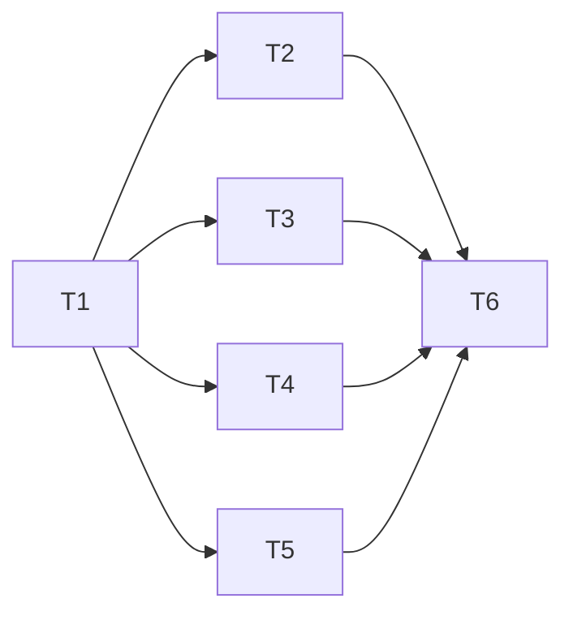

# 深色主題、圓形樣式與單手操作 規格

分支：`feature/dark-theme`
狀態：已確認（2026-10-22，7 項待確認事項皆採建議答案，見文末「已確認的決定」）
樣稿：<https://claude.ai/artifact/6sqztWevMdtZ43iGtYeTwM>（第二版，使用者確認「很喜歡」，淺色也可以）

這個分支做五件事：

- 整個 App 換成選定的配色：深色版本 E，再加一套淺色。
- 元素一律改成圓形或膠囊形。
- 新增設定頁，可以選主題和慣用手。
- 首頁和錄音畫面的按鈕，依慣用手放在拇指那一側。
- 詳細頁的分頁和播放列移到下方，方便單手操作。

桌面模式（手機平放時只留「標記重點」和「停止」）要加感測器套件，另開 `feature/desk-mode` 做，不在這個分支。

## 背景（2026-10-22 討論）

- 首頁時長加上顏色後，使用者覺得整體太單調，從 5 個配色裡選了 **E（夜間）**。
- 看過套到各頁的第一版樣稿，使用者提出四點：
  1. 每段文字或圖形都要用圓形元素包起來，所有頁面規格一致。
  2. 新增設定頁，可以調深色或淺色、左撇子或右撇子。
  3. 錄音時手機通常放在桌上，平放時只留重要功能，並且靠拇指那一側。首頁的 + 要更有特色。手持錄音時，即時文字開關要跟下方按鈕放在一起。
  4. 詳細頁四個分頁太靠上，單手不好按；播放列也要往下移。右上角兩個圖示要換成貼近功能的圖形，「重新分析」如果可以點，要套用第 1 點。

## 現況（寫規格時查過的程式碼）

- **主題**：`lib/main.dart` 只用 `ColorScheme.fromSeed(seedColor: Colors.deepPurple)`，沒有深色模式。
- **寫死的顏色**：共 16 處，散在下面這些檔案：
  - `home_screen`：滑動刪除的紅底
  - `meeting_detail_screen`：選單的刪除、灰色提示
  - `import_screen`：錯誤圖示、灰色提示
  - `live_record_screen`：放棄錄音、錯誤圖示、橘色提示、灰色提示
  - `confirm_delete_dialog`：刪除按鈕
  - `recording_dot`：紅點
- **設定**：`lib/services/settings_store.dart` 目前只有 `live_preview`，存在 `Documents/settings.json`，讀取失敗就用預設值。
- **首頁**（`home_screen.dart`）：
  - `ListTile` 清單，每一列可以左滑刪除。
  - 右下角是 `_ExpandableFab`：按「+」先展開，再選「即時錄音」或「匯入」。
  - 右上角是詞庫按鈕。
- **錄音畫面**（`live_record_screen.dart`）：從上到下依序是：
  - 右上角的「即時文字（草稿）」開關
  - 紅點和計時
  - 波形
  - 即時文字區
  - 「標記重點」「筆記」兩個外框按鈕
  - 「停止」按鈕
- **詳細頁**（`meeting_detail_screen.dart`，1015 行）：
  - 用 `DefaultTabController`，四個分頁的 `TabBar` 放在 `AppBar.bottom`。
  - 播放列在內容最上面。
  - 右上角有兩個按鈕：`refresh`（重新分析，只有已經分析過才顯示）和 `⋮` 選單（用目前詞庫重新轉錄、刪除）。
  - 刪除和重新轉錄都會先跳確認；重新分析按了直接執行。

## 目標與範圍

### 一、主題與顏色

- 兩套配色，數值照樣稿：

| 角色 | 深色 | 淺色 | 用在哪裡 |
|---|---|---|---|
| 背景 | `#14171c` | `#f3f5f8` | 畫面底色 |
| 表面 | `#1d2129` | `#ffffff` | 卡片、播放列 |
| 高表面 | `#282d37` | `#e6eaef` | 選單、選項底、未轉錄 |
| 文字 | `#e8ebf0` | `#15191f` | 主要文字 |
| 次要文字 | `#8d95a3` | `#5d6573` | 日期、說明 |
| 強調（青） | `#6fd3e0` | `#0b7d8c` | 可以點、強調：按鈕、時長、時間戳記、目前分頁、波形 |
| 注意（琥珀） | `#f2b84b` | `#9a5f00` | 待分析、過時提示、重點星號 |
| 完成（綠） | `#6ad69a` | `#1d7f47` | 已完成 |
| 錄音／刪除（紅） | `#ff6b6b` | `#d93a3a` | 錄音紅點、停止、刪除、錯誤 |

- 青、琥珀、綠、紅各有一個淡色底，用在標籤和圓形圖示底，數值照樣稿。
- 寫死的 16 處顏色全部改用主題的顏色，換主題時才會跟著變。
- 主題選項有三種：深色、淺色、跟隨系統，**預設深色**。

### 二、圓形樣式（全部頁面）

- **按鈕、標籤、時間戳記、開關、選項**：膠囊形，兩端全圓。
- **圖示按鈕**：圓形底。清單前面的狀態圖示也放在圓形底裡。
- **整段文字和清單每一列**：用大圓角卡片包起來，圓角約 20。範圍包括首頁每一筆、摘要、筆記、逐字稿每一句、待辦每一項、結構化紀錄的議程、詞庫每一個詞。
- **勾選框**：圓形。
- **對話框**：大圓角，按鈕用膠囊形。

### 三、設定頁（新）

- 入口在首頁右上角的齒輪，放在詞庫旁邊。
- 設定頁的內容：
  - **主題**：深色、淺色、跟隨系統，選了立刻生效。
  - **慣用手**：左手、右手，預設右手，選了立刻生效。
  - **詞庫**：入口，連到現有的詞庫頁。首頁的詞庫按鈕也保留（決定 4）。
- 存在 `settings.json`，新增兩個欄位：`theme_mode`（`dark`／`light`／`system`）、`handedness`（`right`／`left`）。讀不出來或值不認得就用預設值，做法跟 `live_preview` 一樣。

### 四、慣用手

最常按的按鈕放在拇指那一側；左手模式時整排左右對調，文字方向不變。

| 畫面 | 右手（預設） | 左手 |
|---|---|---|
| 首頁 | 錄音鍵和匯入鍵在右下角 | 左下角 |
| 錄音中 | 大的停止鍵在右邊，其他按鈕在左邊 | 對調 |
| 詳細頁播放列 | 播放鍵在右邊，標記和筆記在左邊 | 對調 |

對話框的按鈕順序不變，照系統慣例。

### 五、首頁

- 每一筆改成圓角卡片：
  - 左邊是狀態圖示，放在圓形底裡：未轉錄灰、待分析琥珀、已完成綠。
  - 中間是標題和日期。
  - 右邊是狀態標籤（膠囊形，顏色跟圖示一樣），下面是青色的時長。
- 左滑刪除保留。
- 「+」展開選單改成兩顆按鈕：
  - **大的紅色圓形錄音鍵**：麥克風圖示，按一下直接進入錄音。
  - **小的圓形匯入鍵**：在錄音鍵上方，按一下直接選檔案。
- 右上角：詞庫、設定，都是圓形底的圖示按鈕。

### 六、錄音畫面（手持）

- 上方只留紅點、計時和波形。波形用青色，放在圓角卡片裡。
- 下方是一個操作區：
  - 拇指那一側是**大的紅色圓形停止鍵**。
  - 另一側是「標記重點」「筆記」兩個膠囊按鈕，下面是「即時文字（草稿）」開關，也是膠囊形。
- 即時文字打開時，文字區是一張圓角卡片，放在波形和操作區之間；波形照現在的做法縮小（決定 2）。
- 寫筆記時，輸入框是一張圓角卡片，出現在操作區上方（決定 3）。
- 準備中、轉錄中、錯誤、沒有權限這幾個狀態只換顏色和形狀，版面不變。

### 七、詳細頁

- **分頁移到最下面**：改成底部導覽列，四個項目是摘要、待辦、逐字稿、紀錄，每個都是圖示加文字。目前的項目用膠囊形的淡青色底標示。左右滑動切換分頁保留（決定 5）。
- **播放列移到導覽列正上方**：
  - 改成膠囊形，浮在內容上面。
  - 由右到左是：播放鍵（青色圓形）、時間（目前位置／總長度）、標記重點、新增筆記。
  - 原本的說明文字「點擊逐字稿／待辦／議程項目可跳轉播放」拿掉，改成顯示時間（決定 6）。
- **右上角改成三個圓形圖示按鈕**：

  | 圖示 | 功能 | 什麼時候顯示 | 按了之後 |
  |---|---|---|---|
  | 閃光 | 重新分析 | 已經分析過才顯示，跟現在一樣 | 先確認（決定 1，新增） |
  | 字幕 | 用目前詞庫重新轉錄 | 已經轉錄過才顯示，跟現在一樣 | 先確認，跟現在一樣 |
  | 垃圾桶（紅） | 刪除 | 一律顯示 | 先確認，跟現在一樣 |

- **「分析可能過時」提示**：改成琥珀色的圓角卡片，「重新分析」改成膠囊形按鈕。
- **內容**：
  - 摘要、筆記、逐字稿每一句、待辦每一項、議程都改成圓角卡片。
  - 時間戳記是青色膠囊，點了跳轉播放，跟現在一樣。
  - 勾選框改成圓形。
  - 與會者和「新增」用膠囊標籤。

### 八、其他畫面

- **詞庫、匯入**：套用顏色和圓形樣式，版面不變。
- **對話框**：大圓角，刪除類按鈕用紅色。

**明確不做的事**：

- 桌面模式和平放偵測：另開 `feature/desk-mode`。
- 字型更換：沿用系統字型。
- 錄音畫面以外的動畫。
- Android 的實機驗證：這次不做，記為已知限制。

## API 異動

無對外 API。App 內部的異動：

- **`SettingsStore`**：新增讀寫 `theme_mode`、`handedness` 的方法。
- **App 設定的狀態**：新增一個會通知變化的物件（暫定 `AppSettings`）。App 啟動時，在 `runApp` 之前先讀一次設定，避免畫面先閃一下淺色。設定頁改了選項，就通知 `MaterialApp` 和需要知道慣用手的畫面。
- **主題**：新增 `lib/theme/app_theme.dart`，裡面有：
  - 深淺兩套 `ThemeData`，用自訂的 `ColorScheme`，不用 `fromSeed`，數值照上表。
  - 統一的元件形狀：按鈕、卡片、標籤、勾選框、對話框、輸入框。
  - 一個 `ThemeExtension`，放琥珀、綠、紅和它們的淡色底，讓畫面用語意取顏色。

## 資料表異動

`settings.json` 新增 `theme_mode`、`handedness` 兩個欄位，都可以省略。舊版 App 讀到會忽略。錄音紀錄的格式不變。

## 權限與狀態機

無新權限。各畫面的狀態機不變。

## UI／畫面

以樣稿第二版為準：<https://claude.ai/artifact/6sqztWevMdtZ43iGtYeTwM>。樣稿和這份規格不一樣的地方，以規格為準，例如逐字稿「正在播放的那一句」這次不做（決定 7）。

## 邊界案例與例外處理

- **跟隨系統時，App 開著切換系統深淺色**：立刻跟著變。
- **設定檔讀不出來**：用預設值，也就是深色、右手。
- **長標題**：標題列和首頁卡片的標題一行放不下就截斷（`…`）。右上角有三個圖示，標題的空間比現在小。
- **淺色模式的對比**：青、琥珀、綠在淺色模式用比較深的版本（見上表），白底上的文字也要夠清楚。
- **底部導覽列加上播放列，佔掉下方空間**：內容可以捲到最後一筆，最後一筆不能被播放列擋住。
- **左撇子模式的手勢**：只對調按鈕位置，左滑刪除、左右滑切換分頁的方向不變。
- **未轉錄的錄音**：詳細頁照現在的做法顯示「尚未轉錄」和重新轉錄按鈕，導覽列和播放列照常顯示。

## 測試接縫

- **設定**：`SettingsStore` 單元測試：
  - 主題、慣用手的預設值
  - 寫入後讀回
  - 值不認得時用預設值
  - 不蓋掉 `live_preview`
- **主題**：測試深淺兩套 `ThemeData` 的主要顏色符合上表，並確認 `ThemeExtension` 有琥珀、綠、紅。
- **設定頁**：widget 測試：選淺色後 `MaterialApp` 的主題跟著變；選左手後首頁錄音鍵在左邊。
- **首頁**：widget 測試：
  - 錄音鍵在右手和左手時的位置
  - 按錄音鍵直接進入錄音畫面
  - 狀態標籤的文字
- **錄音畫面**：沿用現有測試，換成新的按鈕和開關位置；另外測停止鍵在右手和左手時的位置。
- **詳細頁**：widget 測試：
  - 底部導覽列切換分頁
  - 右上角三個按鈕的顯示條件
  - 重新分析要先確認
- **實機**：
  - 深色、淺色、跟隨系統都看一遍
  - 左手模式下首頁、錄音、詳細頁的按鈕位置
  - 單手拿手機時，導覽列和播放列好不好按
  - 淺色模式下文字清不清楚

## 任務拆解

2026-10-22 初版：依本規格（決定 1～7）與現有程式碼拆解，使用者同意。全部屬於「可獨立進行」軌道。

**第一批可以開工**：T1
**建議做法**：implement，依序做。T3、T4、T5 不改同一個檔案，理論上可以並行，但每張都要對照樣稿調整，依序做比較好核對。

- [x] **T1 主題基礎**
  - 做完能看到：整個 App 變成深色，按鈕、卡片、標籤、勾選框、對話框是圓形或膠囊形；寫死的 16 處顏色改用主題的顏色；設定檔可以存主題和慣用手
  - 被誰卡住：無，可以直接開工
  - 主要會動的檔案：`lib/theme/app_theme.dart`（新）、`lib/services/app_settings.dart`（新）、`lib/services/settings_store.dart`、`lib/main.dart`、有寫死顏色的 6 個檔案、對應測試
  - 驗收：
    - [x] 深淺兩套主要顏色符合規格的表；`ThemeExtension` 有琥珀、綠、紅
    - [x] `settings.json` 的主題和慣用手可以讀寫，預設深色、右手，值不認得就用預設，不蓋掉 `live_preview`
    - [x] 程式裡不再有 `Colors.red`、`Colors.grey`、`Colors.orange` 這類寫死的顏色
    - [x] `flutter test`、`flutter analyze` 通過
  - 2026-10-22 完成。`ColorScheme` 自訂、不用 `fromSeed`：主色＝青、錯誤＝紅、`tertiaryContainer`＝琥珀淡底（詳細頁「分析可能過時」原本就用它）；琥珀、綠和各個淡色底放在 `AppColors`（`ThemeExtension`）。`AppSettings` 在 `runApp` 前讀一次，用 `AppSettingsScope`（`InheritedNotifier`）往下傳，沒有安裝時用預設值，現有只測單一畫面的測試不用改。紅點、放棄錄音、刪除都用主題的錯誤色（紅）。新增測試 8 個，全部 168 個通過。

- [x] **T2 設定頁**
  - 做完能看到：首頁右上角的齒輪進入設定頁，可以選主題（深色、淺色、跟隨系統）和慣用手，選了馬上生效；設定頁有詞庫入口
  - 被誰卡住：T1
  - 主要會動的檔案：`lib/screens/settings_screen.dart`（新）、`lib/screens/home_screen.dart`（只加入口）、對應測試
  - 驗收：
    - [x] 選淺色後畫面馬上換成淺色，重開 App 還是淺色
    - [x] 選左手後設定有存起來
    - [x] `flutter test`、`flutter analyze` 通過
  - 2026-10-22 完成。新增兩個共用元件：`PillChoice`（膠囊形的多選一，選中的填青色）和 `RoundIconButton`（圓形底的圖示按鈕），T3、T5 會沿用。首頁右上角換成圓形的詞庫、設定兩個按鈕。新增測試 3 個，全部 171 個通過。

- [ ] **T3 首頁改版**
  - 做完能看到：每一筆是圓角卡片，有狀態圖示和狀態標籤；右下角是紅色錄音鍵，按一下直接錄；上方小圓鍵是匯入；左手模式時兩顆鍵在左下角
  - 被誰卡住：T1
  - 主要會動的檔案：`lib/screens/home_screen.dart`、`test/screens/home_screen_test.dart`
  - 驗收：
    - [ ] 錄音鍵直接進入錄音畫面，匯入鍵直接選檔案
    - [ ] 右手和左手時，兩顆鍵的位置正確
    - [ ] 左滑刪除照常
    - [ ] `flutter test`、`flutter analyze` 通過

- [ ] **T4 錄音畫面改版**
  - 做完能看到：上方只有計時和波形；下方操作區有大的紅色停止鍵，拇指那一側；「標記重點」「筆記」「即時文字」開關在另一側
  - 被誰卡住：T1
  - 主要會動的檔案：`lib/screens/live_record_screen.dart`、`lib/widgets/level_waveform.dart`、`lib/widgets/recording_dot.dart`、`test/screens/live_record_screen_test.dart`
  - 驗收：
    - [ ] 現有錄音畫面測試照常通過，包括開關、放棄錄音、保持螢幕開啟
    - [ ] 右手和左手時，停止鍵的位置正確
    - [ ] 即時文字打開時波形縮小，文字卡片在波形和操作區之間（決定 2）；筆記輸入卡片在操作區上方（決定 3）
    - [ ] `flutter test`、`flutter analyze` 通過

- [ ] **T5 詳細頁改版**
  - 做完能看到：分頁在最下面；播放列是膠囊形，在導覽列正上方，顯示時間；右上角是重新分析、重新轉錄、刪除三個圖示；內容都是圓角卡片；重新分析要先確認
  - 被誰卡住：T1
  - 主要會動的檔案：`lib/screens/meeting_detail_screen.dart`、`test/screens/meeting_detail_notes_test.dart`、新的詳細頁測試
  - 驗收：
    - [ ] 點導覽列和左右滑都能切換分頁（決定 5）
    - [ ] 右上角三個按鈕的顯示條件跟規格一樣；重新分析先確認（決定 1）
    - [ ] 播放列顯示「目前位置／總長度」（決定 6），左手時對調
    - [ ] 現有詳細頁測試照常通過
    - [ ] `flutter test`、`flutter analyze` 通過

- [ ] **T6 📱 實機驗證**
  - 做完能看到：深色、淺色、跟隨系統，以及左手模式下各畫面的實際效果；結果寫回本規格
  - 被誰卡住：T2、T3、T4、T5
  - 主要會動的檔案：本規格文件
  - 軌道：可獨立進行（需要使用者本人在 iPhone 上操作）

## 待確認事項

無。

## 已確認的決定（2026-10-22）

| # | 問題 | 決定 |
|---|---|---|
| 1 | 重新分析要先確認嗎 | 要（新增確認）：會呼叫雲端服務、會換掉待辦勾選狀態，移到右上角也容易誤觸 |
| 2 | 即時文字打開時波形怎麼放 | 照現在的做法縮成一條，文字卡片在波形和操作區之間 |
| 3 | 筆記輸入框放哪裡 | 操作區上方的圓角卡片，寫完或取消就收起 |
| 4 | 首頁的詞庫按鈕要保留嗎 | 保留；設定頁也有入口 |
| 5 | 詳細頁保留左右滑切換分頁嗎 | 保留 |
| 6 | 播放列說明文字改成時間嗎 | 改成「目前位置／總長度」 |
| 7 | 逐字稿標示正在播放的句子嗎 | 這次不做，之後另開一項做播放同步 |
