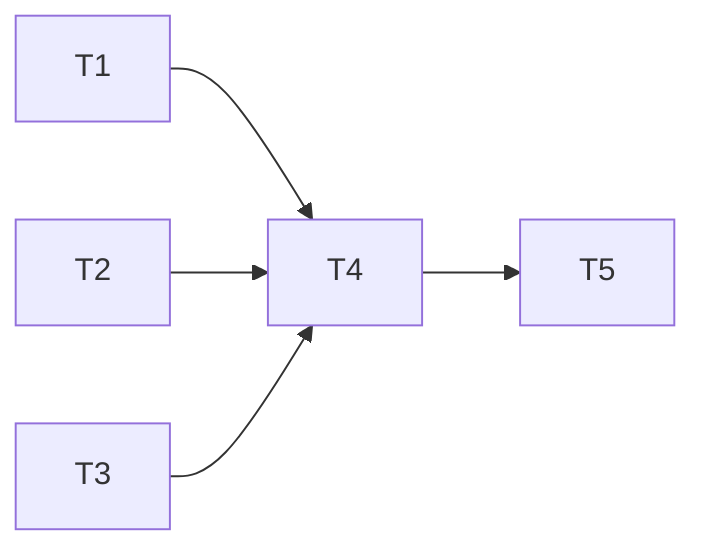

# 錄音狀態指示與即時文字開關 規格

分支：`feature/recording-indicator`
狀態：已確認（2026-10-22，9 項待確認事項皆採建議答案，見文末「已確認的決定」）

這份文件記錄兩件事：

1. **即時文字改成預設關閉**：錄音畫面加一個開關。關閉時完全不啟動即時辨識，只寫 WAV；打開時沿用現有的預覽和重複迴圈收合（`docs/specs/fix-live-preview-repetition/`）。
2. **用動畫讓「正在錄」更明確**：捲動波形取代現在的音量條，加上紅點呼吸閃爍。

## 為什麼要做（2026-10-22 討論）

- **競品的規律**：會顯示即時文字的產品（Otter、Notta），即時文字就是最後的成品；主打錄完再精修的產品（Plaud 官方明說不支援即時轉錄、Good Tape 先錄再上傳）不顯示即時文字；iPhone 語音備忘錄要自己點開才顯示。
- **EchoNote 屬於「錄完再精修」**：停止後用 `base` 重新轉錄。錄音中顯示的卻是 `tiny` 的草稿，品質明顯較差（例如「金主很半斷標準」），會讓使用者誤會轉錄不準。
- **即時辨識的成本**：每 3 秒重算一次，造成手機發熱和耗電。
- **使用者錄音時真正要確認的**：App 還在錄、聲音有收進去。計時器和音量條已經做到，但可以更明確。

**明確不做的事**：

- 鎖螢幕或切到其他 App 後繼續錄音（目前會停止，`LiveEndReason.backgrounded`）。使用者確認這不是預期行為，**另開一項**評估，不在這份規格。
- 即時文字的品質改善（換模型、帶詞庫）。
- 正式逐字稿（離線 `base` 轉錄）的任何改動。

## 現況（寫規格時查過的程式碼）

- `LiveRecordScreen._begin()`（`lib/screens/live_record_screen.dart`）：檢查權限 → `ensureModels()` 下載 `tiny`（即時預覽，約 75 MB）和 `base`（離線，約 147 MB）→ `LiveTranscriptionService.start()`。
- `LiveTranscriptionService.start()`（`lib/services/live_transcription_service.dart`）**一定**會用 `transcribeLive()` 開啟辨識 session；`LiveRecording` 的預覽文字（`preview`）、延遲提示（`notices` 的 previewDelayed／previewStopped）、debug 統計（`[live-metrics]`）、停止時的最終預覽文字，全部依賴這個 session。
- 音量：`LiveRecording.level` 每 100 ms 一個值（echo_core 算的 RMS，0～1），畫面用 `_levelToBar()` 換成 dB 刻度（-60 dBFS 為空、0 dBFS 為滿），以 `LinearProgressIndicator` 顯示。
- 錄音中畫面（`_buildRecording()`）：紅點圖示（靜態）＋計時器、音量條、各種提示、「即時預覽」標題和文字區（佔滿剩餘空間）、★／筆記按鈕、停止按鈕。
- 筆記的時間戳取 `sentSeconds`，和辨識無關，關閉即時文字不影響筆記。

## 目標與範圍

### A. 即時文字開關

- 錄音畫面有一個「即時文字」開關，**預設關閉**。
- **關閉時**：不建立辨識 session，不載入 `tiny`；只寫 WAV、算音量。畫面不顯示即時文字區塊和「即時文字可能延遲」等提示。
- **打開時**：行為和現在一樣（`tiny` 預覽、迴圈收合、延遲提示）。
- 停止後的流程不變：存成未轉錄紀錄 → 離線 `base` 轉錄 → 進詳細頁。
- **錄音中可以切換**（決定 1）：中途打開時才開始辨識，只顯示打開之後的內容，並註明「從現在開始」；中途關閉時停止辨識並隱藏預覽區（決定 1 於 2026-10-22 修訂）。關掉再打開時清空，從新的地方開始，前後不接（決定 7）。
- **記住上次的選擇**（決定 2）：存在本機 `Documents/settings.json`，不另外加套件。第一次使用時是關閉。
- **`tiny` 第一次打開時才下載**（決定 3）：即時文字關閉時，開始錄音前只確保 `base` 存在；第一次打開開關時才下載 `tiny`，下載期間開關旁顯示進度。

### C. 放棄錄音（2026-10-22 實機驗收時加入，決定 10～13）

- 錄音中按返回，對話框有三個選項：**放棄錄音**（紅字，和其他兩個分開）、繼續錄音、停止並存檔。
- 選「放棄錄音」後再確認一次：「確定放棄？這段錄音和筆記都會刪除，無法復原。」
- 確定後停止錄音、刪除錄音檔，不存成任何紀錄、不跑轉錄，筆記一起丟棄，回到上一頁，就像沒錄過一樣。
- 錄音畫面上不另外放「放棄」按鈕，只放在返回的對話框裡，避免誤觸。

### B. 錄音狀態動畫

- **捲動波形**取代音量條：保留最近 6 秒（60 格，每格 100 ms，決定 4）的音量，每 100 ms 往左推一格，最新的在右邊；有講話時起伏，安靜時接近平線。高度沿用 `_levelToBar()` 的 dB 刻度。
- **紅點呼吸閃爍**：計時器旁的紅點以約 1 秒為週期淡入淡出，錄音停止（`finalizing`／`transcribing`）時停下。
- 系統設定「減少動態效果」開啟時，紅點不閃爍、改成常亮；波形照常更新（它是資料，不是裝飾）。

## API 異動

無對外 API。App 內部：

- `LiveTranscriptionService.start()` 新增參數（暫定 `livePreview: bool`），為 `false` 時不呼叫 `transcribeLive()`。
- `LiveRecording` 改成可以沒有辨識 session：`preview` 不會有資料、`notices` 不會有預覽相關提示、停止時的最終預覽文字為空字串、debug 不輸出 `[live-metrics]`。
- `ensureModels()` 改成可以只確保 `base`；`tiny` 在第一次打開即時文字時才下載（決定 3）。
- `LiveRecording` 可以在錄音中途開始、停止辨識（決定 1）；停止時的最終預覽文字，即時文字沒開時為空字串（`previewText` 欄位保留，決定 8）。

## 資料表異動

錄音存檔格式不變。新增本機設定檔 `Documents/settings.json`，目前只有一個值：`live_preview: bool`，預設 `false`；檔案不存在或損毀時視為預設值（決定 2）。

## 權限與狀態機

錄音畫面的狀態（`_Phase`）不變：`checkingPermission → preparing → recording → finalizing → transcribing`。新增的只是 `recording` 階段裡「即時文字開／關」這個子狀態。

## UI／畫面

**暫定，待正式設計。** 目前 App 用 Flutter 預設 Material 主題。以下只確定元素和行為，尺寸、顏色、版面都暫定。

| 元素 | 即時文字關閉 | 即時文字打開 |
|---|---|---|
| 紅點＋計時器 | 紅點呼吸閃爍 | 同左 |
| 波形 | 顯示，佔較大的空間（取代原本的預覽區） | 顯示，高度較小，下面是預覽區 |
| 即時文字開關 | 顯示 | 顯示 |
| 「即時預覽」標題和文字區 | 不顯示 | 顯示（沿用現在） |
| 延遲提示 | 不顯示 | 沿用現在 |
| 2 小時上限提示 | 顯示 | 顯示 |
| ★／筆記、停止 | 不變 | 不變 |

開關放在計時器那一行的右邊，文案「即時文字（草稿）」（決定 5）。

## 邊界案例與例外處理

- **即時文字關閉時，筆記照常**：筆記的時間戳取自寫入 WAV 的位置，跟辨識無關。
- **即時文字打開時辨識出錯**：沿用現有的「即時文字已停止，錄音仍在進行」提示。
- **重播除錯工具**（`LIVE_REPLAY_WAV`）：開啟時即時文字預設打開，不讀也不寫設定檔（決定 6）。
- **第一次打開時 `tiny` 下載失敗**（例如沒有網路）：開關退回關閉並提示原因，錄音照常進行。
- **波形在錄音一開始**：還沒有歷史資料時，空的部分顯示成平線，不要縮放或跳動。
- **非常大聲或沒有聲音**：沿用 `_levelToBar()` 的上下限（-60～0 dBFS 夾住）。

## 測試接縫

- **`LiveRecording` 沒有 session 的情況**：用假的麥克風串流（例如沿用 `WavReplayMic` 的做法注入 PCM）建立錄音，確認 WAV 正常寫入、`level` 有資料、停止時 `previewText` 為空、`preview` 沒有資料。這也讓 `LiveRecording` 第一次可以寫單元測試（之前因為一定要有真的辨識 session 而測不了）。
- **波形的資料結構**：純 Dart 的固定長度緩衝（暫定 `LevelHistory`），測試推入、滿了之後丟掉最舊的、換算成 0～1 高度。
- **畫面**：widget 測試確認開關預設關閉、關閉時沒有預覽區、打開後出現預覽區；減少動態效果時紅點不閃爍。
- **實機**：iPhone 上確認波形和閃爍的觀感；開、關即時文字各錄 10 分鐘，記錄電量差和手機摸起來的溫度，有明顯差距就算達成（決定 9）。

---

## 任務拆解

2026-10-22 初版：依本規格（決定 1～9）與現有程式碼（`LiveTranscriptionService`、`LiveRecording`、`LiveRecordScreen._buildRecording()`）拆解。全部屬於「可獨立進行」軌道；專案沒有 `CLAUDE.md`，不需要對照風險清單。

**第一批可以開工**：T1、T2、T3（T3 和 T4 都改 `live_record_screen.dart`，所以 T4 排在 T3 後面）
**建議做法**：依序一張一張做（T1 → T2 → T3 → T4），每張份量不大

- [x] **T1 錄音可以不開辨識，並可在中途開、關**
  - 做完能看到：即時文字關閉時只寫 WAV、算音量，不啟動辨識；錄音中可以開始、停止辨識；開始錄音前只確保 `base`
  - 被誰卡住：無，可以直接開工
  - 主要會動的檔案：`lib/services/live_transcription_service.dart`、`test/services/live_recording_test.dart`（新）
  - 軌道：可獨立進行
  - 驗收：
    - [x] 沒開辨識時：WAV 正常寫入、`level` 有資料、`preview` 沒有資料、停止時 `previewText` 為空、不輸出 `[live-metrics]`
    - [x] 中途開始辨識：只把開始之後的音訊送進辨識；中途停止：之後不再有預覽文字
    - [x] 停止錄音時如果辨識還開著，照常取最終預覽文字
    - [x] `ensureModels()` 預設只確保 `base`；另有確保 `tiny` 的方法，並回報下載進度
    - [x] `flutter test`、`flutter analyze` 通過
  - 2026-10-22 完成。`LiveRecording` 改成公開建構子，辨識透過 `PreviewSession` 介面注入（實際用 `transcribeLive()`，測試用假的），第一次有單元測試（6 個）。中途打開時，延遲以「這次辨識開始的位置」為起點計算。錄音畫面暫時維持舊行為（開始錄音前下載 `tiny`、一律打開預覽），T4 再接上開關。

- [x] **T2 本機設定檔**
  - 做完能看到：「即時文字」的開關狀態會記住，下次錄音沿用
  - 被誰卡住：無，可以直接開工
  - 主要會動的檔案：`lib/services/settings_store.dart`（新）、`test/services/settings_store_test.dart`（新）
  - 軌道：可獨立進行
  - 驗收：
    - [x] 讀寫 `Documents/settings.json` 的 `live_preview`，預設 `false`
    - [x] 檔案不存在或損毀時回傳預設值；寫入時保留檔案裡其他未知的欄位
    - [x] `flutter test`、`flutter analyze` 通過
  - 2026-10-22 完成。值的型別不對（例如字串）也當作預設值；設定是非關鍵資料，檔案損毀時下次存檔直接覆蓋（和詞庫「不覆寫」的做法不同）。

- [x] **T3 捲動波形和紅點呼吸閃爍**
  - 做完能看到：錄音畫面的音量條換成 6 秒的捲動波形，紅點會呼吸閃爍；「減少動態效果」開啟時紅點常亮
  - 被誰卡住：無，可以直接開工
  - 主要會動的檔案：`lib/widgets/level_waveform.dart`（新，含 `LevelHistory`）、`lib/widgets/recording_dot.dart`（新）、`lib/screens/live_record_screen.dart`、對應的測試
  - 軌道：可獨立進行
  - 驗收：
    - [x] `LevelHistory` 固定 60 格，滿了丟掉最舊的；高度沿用 `_levelToBar()` 的 dB 換算（-60～0 dBFS）
    - [x] 一開始沒有歷史時，空的部分是平線
    - [x] 錄音中紅點閃爍，`finalizing`／`transcribing` 時停下；減少動態效果時常亮
    - [x] `flutter test`、`flutter analyze` 通過
  - 2026-10-22 完成，**尚未實機確認觀感**。`_levelToBar()` 搬到 `level_waveform.dart` 改名 `levelToHeight()`；紅點每 0.5 秒淡入或淡出一次（一個呼吸約 1 秒），最暗 25%。紅點只在錄音中的畫面出現，`finalizing`／`transcribing` 用的是其他畫面，自然不會閃。

- [x] **T4 錄音畫面的即時文字開關**
  - 做完能看到：計時器右邊有「即時文字（草稿）」開關，預設跟著設定檔；關閉時沒有預覽區、波形較大；中途打開時顯示「從現在開始」；第一次打開時下載 `tiny` 並顯示進度，失敗就退回關閉並提示；重播工具開啟時預設打開
  - 被誰卡住：T1、T2、T3
  - 主要會動的檔案：`lib/screens/live_record_screen.dart`、`test/screens/live_record_screen_test.dart`（新）
  - 軌道：可獨立進行
  - 驗收：
    - [x] 開關預設讀設定檔，切換時寫回（重播工具開啟時不讀也不寫）
    - [x] 關閉時不顯示預覽區和延遲提示；打開時沿用現在的預覽
    - [x] 關掉再打開時清空舊文字
    - [x] `tiny` 下載失敗時開關退回關閉並顯示原因，錄音不中斷
    - [x] `flutter test`、`flutter analyze` 通過
  - 2026-10-22 完成，**尚未實機驗證**。錄音一律先不帶辨識開始，再依設定打開即時文字，所以 `tiny` 下載或辨識失敗都只會讓開關退回關閉、顯示提示，不會讓錄音失敗。下載或載入期間開關停用並顯示進度。`LiveRecordScreen` 新增 `mic`／`service`／`settings` 三個測試接縫，加了 5 個 widget 測試。
  - 規格矛盾（決定 1「保留文字」對上 UI 表格「關閉時不顯示預覽區」）：使用者決定照實作，決定 1 已修訂。

- [x] **T5 📱 實機驗證**
  - 做完能看到：波形與閃爍的觀感、省電降溫的對照、中途開關與第一次下載 `tiny` 的流程，結果寫回本規格
  - 被誰卡住：T4
  - 主要會動的檔案：本規格文件
  - 軌道：可獨立進行（需要使用者本人在 iPhone 上操作）
  - 驗收：
    - [x] 波形和紅點看起來能確認「正在錄」
    - [x] 開、關即時文字各錄 10 分鐘，記錄電量差和溫度，有明顯差距
    - [x] 中途打開、關閉、再打開都正常
    - [x] 刪掉 `tiny` 後第一次打開會下載並顯示進度
  - 2026-10-22 使用者實機驗收：第 1～5 步（預設關閉、中途打開與下載、關掉再打開、記住選擇、減少動態效果）都正常。
  - 開、關即時文字各錄 10 分鐘：耗電和溫度**差異不明顯**。預設關閉的理由維持「預覽品質會讓使用者誤會轉錄不準」，省電不是主要理由（決定 13）。
  - 使用者發現錄音中按返回沒有「放棄這次錄音」的選項，加入範圍 C（決定 10～12）。實作在 `_confirmLeave()`／`_confirmDiscard()`，放棄時 `_onRecordingDone()` 刪除 WAV 後直接返回；加 2 個 widget 測試（放棄後沒有任何錄音檔和紀錄、第二次確認取消時照常錄音）。**放棄錄音尚未實機驗證**。
  - 測試踩坑：推入新頁面或開啟對話框後，`pump()` 不帶時間就不會讓轉場動畫跑完，之後每次 `runAsync` 都會慢到約 680 ms，兩個測試各卡 85 秒；`settle` 改成每輪讓假時鐘前進 50 ms 後恢復正常。

## 待確認事項

無。

## 已確認的決定（2026-10-22）

| # | 問題 | 決定 |
|---|---|---|
| 1 | 錄音中可以切換嗎 | 可以；中途打開只顯示之後的內容並註明「從現在開始」，中途關閉時停止辨識並隱藏預覽區（2026-10-22 修訂：原本寫「保留已顯示的文字」，和 UI 表格「關閉時不顯示預覽區」及決定 7「重新打開時清空」矛盾，保留的文字永遠看不到） |
| 2 | 要記住上次的選擇嗎 | 要，存在 `Documents/settings.json`，不加套件 |
| 3 | 關閉時還要先下載 `tiny` 嗎 | 不要，第一次打開時才下載，期間顯示進度 |
| 4 | 波形保留多久 | 6 秒，60 格 |
| 5 | 開關位置與文案 | 計時器那一行的右邊，「即時文字（草稿）」 |
| 6 | 重播工具開啟時的預設 | 即時文字打開 |
| 7 | 關掉再打開，文字要接起來嗎 | 不接，重新打開時清空 |
| 8 | 最終預覽文字要保留嗎 | 欄位保留，即時文字沒開時給空字串，這次不刪 |
| 9 | 省電降溫要量化嗎 | 要，開、關各錄 10 分鐘比較電量差和溫度 |
| 10 | 放棄錄音放在哪 | 放在錄音中按返回的對話框，三個選項，「放棄錄音」紅字並和其他分開；錄音畫面不另外放按鈕 |
| 11 | 放棄要不要再確認 | 要，「確定放棄？這段錄音和筆記都會刪除，無法復原。」 |
| 12 | 放棄後保留什麼 | 什麼都不留：刪錄音檔、不存紀錄、不轉錄、筆記丟棄 |
| 13 | 耗電差異不明顯，預設還要關嗎 | 維持關閉，主要理由是預覽品質，不是省電 |
