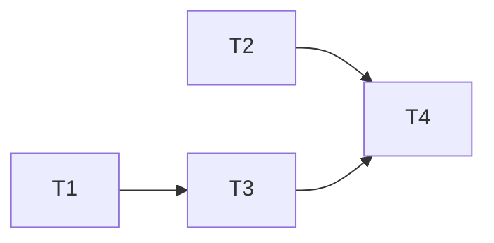

# 即時預覽重複迴圈 規格

分支：`fix/live-preview-repetition`
狀態：已確認（2026-10-22，7 項待確認事項皆採建議答案，見文末「已確認的決定」）

即時錄音時，畫面上的即時預覽常出現一長串重複的字，例如「經常經常經常…」「Helps,Helps,Helps,…」「金主很半斷標準，金主很半斷標準，…」。2026-10-21 量測 T6 時，帶詞庫和不帶詞庫的兩組都有，所以跟詞庫無關（`docs/specs/feature-user-context/`，決定 24）。

這只影響**錄音中的預覽**：正式逐字稿是停止後用 `base` 模型重新轉錄的，不受影響。但預覽是使用者錄音時唯一看得到的回饋，大段重複會讓人以為錄音壞了。

## 現況（寫規格時查過的程式碼）

- 即時預覽的設定在 `lib/services/live_transcription_service.dart` 的 `kLivePreviewConfig`：`tiny` 模型、4 執行緒、每 3 秒重新辨識（`stepSec: 3`）、**關掉 temperature fallback**（`noFallback: true`）、每次最多 64 個 token（`maxTokens: 64`）、`audioCtx: 768`、每 15 秒定稿一次（`commitSec: 15`）、prompt 只有固定開頭。
- 原生端（`packages/whisper_ggml/ios/Classes/whisper_flutter_plus.cpp`，iOS／Android 共用）：
  - `stream_run_inference()` 每次把目前的視窗（最多 15 秒）整段重新辨識，`no_context = true`。
  - 預覽文字 = `committed`（已定稿）＋`last_text`（目前視窗）。
  - 視窗滿 15 秒時，**整段 `text` 直接接到 `committed` 後面**（`committed += text`），沒有任何檢查。
- **為什麼關掉 fallback**：whisper 的 temperature fallback 會在結果不可靠時（壓縮率過高或平均機率太低，重複迴圈就屬於這種）換溫度整段重新辨識，最多 5 次。2026-10-08 實測時，它讓延遲累積到 216 秒、手機發燙，所以即時預覽把它關掉（`docs/devlogs/feature-native-mic-stream.md`）。代價是：**whisper 原本用來丟掉重複結果的機制也一起失效了。**
- 前例：echo_core 第 2 週把 `audio_ctx` 改成「依每次長度調整」（`-1`）時，也出現「有一個字，有一個字……」的重複，當時判斷原因同樣是 fallback 被關掉（`docs/devlogs/feature-echo-core-w2.md` 第 3 點）。改回固定 768 之後問題變少，但沒有消失。
- 推論的機制（**尚未驗證**）：某個視窗陷入迴圈時，會一路生到 64 個 token 的上限；如果這個結果剛好在定稿那一刻產生，迴圈的內容就會永久留在預覽上。

## 目標與範圍

- 即時預覽**不再顯示**連續重複的迴圈。
- 不能讓預覽變慢：和 2026-10-21 T6 的對照組（median total_ms 503、max lag 1.6 s）相比，median 增加不超過 20%，max lag 不超過 3 秒（沿用 T6 的門檻）。
- 先找出能穩定重現的方法，再修正；修正前後要用同一段音訊比較。

**「重複迴圈」的定義**（用來量測和寫測試）：同一段 1～10 字（code point）的文字，**連續出現 4 次以上**；比對時忽略夾在中間的標點和空白（決定 3）。收合時保留一次，其他文字不動（決定 5）。例如「經常」×30、「Helps,」×20、「金主很半斷標準，」×4。

**可能的修法**（採 **A＋B**，見決定 1）：

| 做法 | 改在哪裡 | 優點 | 缺點 |
|---|---|---|---|
| A. 顯示前收合重複 | Dart 端，把預覽文字裡的迴圈收成一次 | 不碰原生、好寫測試、不影響速度 | 只遮住結果；迴圈照樣耗掉解碼時間 |
| B. 定稿前檢查，迴圈不定稿 | 原生端 `stream_run_inference()`：偵測到迴圈時，這個視窗的文字不接進 `committed`（或先收合再接） | 從源頭擋住永久殘留 | 要改 C++；被丟掉的視窗那 15 秒預覽會變空 |
| C. 有限度地打開 fallback | 原生端：只在偵測到迴圈時重試 1 次（溫度調高一點） | 有機會換到正確的文字 | 會變慢，2026-10-08 曾累積到 216 秒延遲；要重新量測 |
| D. 調低 `maxTokens` | `kLivePreviewConfig` | 改一個數字 | 迴圈變短但沒消失，正常的長句也可能被截掉 |

**明確不做的事**：

- 換掉 `tiny` 模型，或改用串流辨識引擎。
- 正式逐字稿（離線 `base` 轉錄）的任何改動。
- 即時預覽帶詞庫（決定 24 已經否決）。

## API 異動

無對外 API。B 在原生端 `stream_run_inference()`（以及 `stream_stop()` 的最後一次）定稿前收合迴圈，屬於 vendored `whisper_ggml` 內部行為；是否用 `stream_start` 參數開關，於實作時決定，預設開啟。

## 資料表異動

無。即時預覽的文字不會存檔。

## 權限與狀態機

無。

## UI／畫面

不改畫面。即時預覽區塊只是文字內容不同。

## 邊界案例與例外處理

- **真的有人重複講同一句話**（例如「好好好好」「對對對對」、唸口號）：會被當成迴圈收合。預覽只是暫時的回饋，正式逐字稿不受影響，所以可以接受；用重播 WAV 看誤判多不多再調整門檻（決定 3）。
- **迴圈跨過定稿邊界**：前半在 `committed`、後半在目前視窗。檢查時連同已定稿文字的最後 40 字一起看（決定 4）。
- **迴圈單位比 10 字長**：例如整句重複。定義只抓 1～10 字，較長的整句重複不在這次範圍。
- **迴圈中間夾簡體字或不同標點**（例如「經常經常經經常」）：標點已忽略；字不完全一樣的重複這次抓不到，接受。
- **停止錄音時的最後一次辨識**（`stream_stop()`）：如果在原生端修（B、C），這一次也要套用同樣的檢查。

## 測試接縫

- **純函式**：`collapseRepetitions(String text) → String`（名稱暫定），依上面的定義收合連續重複。用 T6 留下的三段實際輸出當測試資料，再加上「正常句子不受影響」「好好好好」等案例。A、B 都會用到；B 的話 C++ 端要有對應的實作，或者由 Dart 端呼叫。
- **重現方法**：debug 專用開關（暫定 `--dart-define=LIVE_REPLAY_WAV=<檔名>`），錄音畫面改從 App 裡現有錄音的 WAV 用即時速度餵音訊，取代麥克風（決定 2）。
- **量測**：沿用 debug 模式的 `[live-metrics]`（median total_ms、max lag），另外加上收合的迴圈次數，只在 debug 輸出（決定 6）。
- **驗證環境**：iPhone 12 Pro Max debug 模式重播 T6 的兩段 WAV，比較修正前後的迴圈數和延遲；再實際錄 2～3 分鐘確認。Android 這次不驗（決定 7）。

---

## 任務拆解

2026-10-22 初版：依本規格（決定 1～7）與現有程式碼（`kLivePreviewConfig`、`whisper_flutter_plus.cpp` 的 `stream_run_inference()`／`stream_stop()`、`MicStreamService`）拆解。全部屬於「可獨立進行」軌道；專案沒有 `CLAUDE.md`，不需要對照風險清單。

**第一批可以開工**：T1、T2（不改同一檔案，可以同時做）
**建議做法**：依序一張一張做（共 4 張，未達並行門檻）

- [x] **T1 Dart 端收合重複（A）＋共用測試資料**
  - 做完能看到：即時預覽上的重複迴圈只剩一次，其他文字不動；debug 的 `[live-metrics]` 摘要多一項「收合了幾次」
  - 被誰卡住：無，可以直接開工
  - 主要會動的檔案：`lib/services/repetition.dart`（新）、`lib/services/live_transcription_service.dart`（`LiveRecording` 收到 partials 後、送出預覽前收合）、`test/fixtures/repetition_cases.json`（新）、`test/services/repetition_test.dart`（新）
  - 軌道：可獨立進行
  - 驗收：
    - [x] `collapseRepetitions` 依規格定義收合（1～10 字、連續 4 次以上、忽略中間標點空白、保留一次、其他文字不動），並回傳收合次數
    - [x] 測試資料含 T6 的三段實際輸出（經常…、Helps,…、金主很半斷標準…）、「好好好好」、正常句子、只重複 3 次不收合、跨標點的重複
    - [x] 預覽顯示的文字經過收合；`[live-metrics]` 摘要輸出收合次數（只在 debug）（接線沒有單元測試，`LiveRecording` 需要真的辨識 session，留給 T4 實機確認）
    - [x] `flutter test`、`flutter analyze` 通過
  - 2026-10-22 完成。分隔字元用明確的字元範圍（不用 Unicode 類別），讓 C++ 版能完全一致。T6 的經常迴圈中間夾一個殘字「經」，所以收成兩段、留下「經常經經常經」，可以接受。

- [ ] **T2 重播 WAV 取代麥克風（debug 專用）**
  - 做完能看到：`flutter run --dart-define=LIVE_REPLAY_WAV=<錄音檔名>` 啟動後，開始即時錄音時改用即時速度播放 App 裡那段錄音的 WAV，每 100 ms 一段，同一段音訊可以反覆重跑
  - 被誰卡住：無，可以直接開工
  - 主要會動的檔案：`lib/services/wav_replay_mic.dart`（新，和 `MicStreamService` 相同的 `start()`／`stop()` 介面）、`lib/screens/live_record_screen.dart`（有開關時把它傳給 `LiveTranscriptionService(mic: …)`，略過麥克風權限）、`test/services/wav_replay_mic_test.dart`（新）
  - 軌道：可獨立進行
  - 驗收：
    - [ ] 跳過 44 bytes 檔頭，依 16 kHz mono PCM16 切成 100 ms 一段；檔案讀完就結束串流，等同按下停止
    - [ ] 節奏可注入（測試用不等真實時間），預設即時速度
    - [ ] 找不到檔案時錄音畫面顯示錯誤，不改用麥克風
    - [ ] 沒設開關時行為和現在完全一樣
    - [ ] `flutter test`、`flutter analyze` 通過

- [ ] **T3 原生端在定稿前收合（B）＋`LIVE_COLLAPSE` 開關**
  - 做完能看到：重複迴圈不會再永久留在已定稿的預覽裡；`--dart-define=LIVE_COLLAPSE=false` 會同時關掉 A 和 B，同一個 build 就能做前後對照
  - 被誰卡住：T1（沿用同一套演算法和測試資料）
  - 主要會動的檔案：`packages/whisper_ggml/ios/Classes/collapse_repetitions.h`（新，header-only）、`packages/whisper_ggml/ios/Classes/whisper_flutter_plus.cpp`（`stream_run_inference()` 定稿前、`stream_stop()` 最後一次都收合，檢查範圍含 `committed` 的最後 40 字；`stream_start` 讀 `collapse_repetitions` 參數，預設開啟；每次辨識的 metrics 加收合次數）、`packages/whisper_ggml/lib/src/whisper_live.dart`／`whisper_controller.dart`（把參數傳下去）、`lib/services/live_transcription_service.dart`（`LIVE_COLLAPSE` 開關）、`packages/whisper_ggml/test_native/collapse_repetitions_test.cpp`（新，Mac 上用 `clang++` 執行，讀同一份 `test/fixtures/repetition_cases.json`）
  - 軌道：可獨立進行
  - 驗收：
    - [ ] C++ 測試讀共用測試資料，結果和 Dart 版一致
    - [ ] `flutter build ios` 通過（C++ 有編進去）
    - [ ] 開關關閉時，原生和 Dart 都不收合
    - [ ] `flutter test`、`flutter analyze` 通過

- [ ] **T4 📱 實機驗證**
  - 做完能看到：同一段音訊、開關開與關的迴圈數與延遲對照表，寫回本規格
  - 被誰卡住：T2、T3
  - 主要會動的檔案：本規格文件
  - 軌道：可獨立進行（需要使用者本人在 iPhone 上操作）
  - 驗收：
    - [ ] iPhone 12 Pro Max debug 模式，重播 T6 的兩段 WAV，各跑 `LIVE_COLLAPSE=false` 和預設兩次，記下 `[live-metrics]` 的迴圈數、median total_ms、max lag
    - [ ] 開啟收合後，預覽裡沒有符合定義的重複迴圈
    - [ ] median total_ms 不比關閉時多 20% 以上，max lag 不超過 3 秒
    - [ ] 實際錄 2～3 分鐘，預覽沒有重複迴圈
    - [ ] 「好好好好」這類誤判的情況記在備註，決定要不要調門檻

## 待確認事項

無。

## 已確認的決定（2026-10-22）

| # | 問題 | 決定 |
|---|---|---|
| 1 | 採用哪一種修法 | A＋B：原生端定稿前收合迴圈，Dart 端顯示前再收合目前視窗；C 會變慢先不做，D 治標不治本 |
| 2 | 怎麼穩定重現 | debug 專用開關，用即時速度重播 App 裡現有錄音的 WAV，取代麥克風；優先用 T6 那兩段 |
| 3 | 迴圈門檻 | 1～10 字連續 4 次以上，忽略中間的標點和空白；重播後看誤判再調 |
| 4 | 檢查範圍 | 目前視窗＋已定稿文字的最後 40 字 |
| 5 | 收合後怎麼呈現 | 只收合重複部分，其他文字保留 |
| 6 | 要不要記錄次數 | 要，只在 debug 的 `[live-metrics]` 輸出 |
| 7 | 驗證環境 | iPhone 12 Pro Max debug 重播 T6 兩段 WAV 比較前後，再實錄 2～3 分鐘；Android 不驗 |
